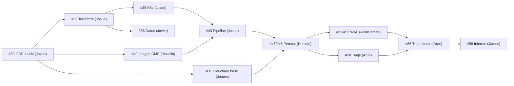

# Plan de trabajo por persona

Este archivo responde una sola pregunta: **¿qué hago ahora y qué va después?**
La fuente de verdad del estado son las **issues**; este documento fija el **orden** y las dependencias. Si el orden cambia, se actualiza aquí en el mismo PR.

- Reparto y responsabilidades: [`reparto-trabajo.md`](reparto-trabajo.md)
- Fechas e hitos: [`cronograma.md`](cronograma.md)
- Rúbrica → evidencia: [`rubrica-trazabilidad.md`](rubrica-trazabilidad.md)
- Backlog: https://github.com/Joliva07/ProyectoFinal_SeguridadEnAplicaciones/issues

## 1. Cómo se usa

1. Toma la **primera tarea de tu lista cuyo requisito ya exista**.
2. Marca la issue con `estado/en-curso` y asígnatela.
3. Al terminar: PR → revisión cruzada → merge → cierra la issue y tacha la fila aquí.
4. Si te bloqueas más de 24 h: comenta en la issue con `estado/bloqueado`, nombra qué falta y **pasa a la siguiente tarea tuya que no dependa de eso**.
5. Nunca empieces una tarea cuyo "Depende de" no esté cerrado; si crees que puedes adelantarla, dilo en la issue antes.

Estados: `estado/en-curso` · `estado/bloqueado` · `estado/revision` (PR abierto esperando revisión) · cerrada = hecha.

## 2. Arranque inmediato (18–20 nov)

| Persona | Primera tarea | Por qué primero |
|---|---|---|
| Javier | **#30** cuenta/proyecto GCP + IAM + WIF, y **#32** presupuesto | Desbloquea a Josue, Horacio y Arun |
| Josue | **#37** arquitectura C4 + invitaciones al repo | Desbloquea a Javier (ubicación de activos) y a Horacio |
| Horacio | **#40** imagen WordPress endurecida | Desbloquea pipeline y pentest |
| Arun | **#41** plantillas SIEM/WAF + matriz OWASP | No depende de nadie |
| James | **#31** Cloudflare: DNS, TLS, WAF base, Access | Desbloquea pentest y la aplicación del WAF |

## 3. Javier — activos y riesgo · dueño de la cuenta GCP

| # | Tarea | Issue | Depende de | Entregable | Listo cuando |
|---|---|---|---|---|---|
| 1 | Cuenta GCP, proyecto, APIs, IAM, WIF, presupuesto | #30 #32 | — | Proyecto operativo, accesos otorgados | `gcloud` describe sin endpoint público; matriz IAM aplicada |
| 2 | Inventario de activos ISO 27001 | #33 | #37 | `inventario-activos.md` + CSV | 26+ activos con 7 campos y criticidad |
| 3 | Dataset sintético y cuentas demo | #36 | #30, #38 | CSV importable + usuarios `demo-*` | Catálogo y pedidos cargados en `dev` y `demo` |
| 4 | Clasificación CIA y criticidad | #34 | #33 | `clasificacion-cia.md` | 14 críticos justificados y regla de revisión |
| 5 | STRIDE, DREAD y matriz inicial | #35 | #37, #33 | `stride.md`, `dread.md`, `matriz-riesgos.md` | 28 riesgos, ≥1 por capa, IDs estables |
| 6 | Matriz v2 con hallazgos reales | #51 | #45–#48 | Matriz actualizada | Cada `H-NN` mapeado a `R-NN` |
| 7 | Teardown y facturación final | #60 | Todos | Captura de costos + recursos eliminados | Evidencias preservadas |

Ojo: el **primer `terraform apply` del bootstrap** lo ejecutas tú (eres el único con `owner`); después aplica solo el pipeline.

## 4. Josue — arquitectura y DevSecOps · owner del repo

| # | Tarea | Issue | Depende de | Entregable | Listo cuando |
|---|---|---|---|---|---|
| 1 | Invitaciones al repo (Javier, Arun) y protecciones de `main` | — | — | Accesos entregados | Todos con write; PR obligatorio |
| 2 | Arquitectura objetivo (C4, flujo de checkout, IAM, cifrado) | #37 | — | `arquitectura-seguridad.md` + diagramas | Cloudflare→Ingress→pods→MySQL documentado |
| 3 | Terraform: VPC, GKE Autopilot privado, Cloud SQL, GCS, KMS | #38 | #30 | `infra/` aplicable | `apply` reproducible; SQL privado con CMEK |
| 4 | Manifiestos K8s endurecidos | #39 | #38 | `infra/k8s/` | PSA `restricted`, NetworkPolicy, read-only, RBAC mínimo |
| 5 | Pipeline mínimo (build + deploy por WIF) | #43 | #38, #39, #40 | Workflow en `.github/` | Tienda desplegada desde CI, sin claves |
| 6 | SAST/SCA/WPScan/Trivy/Checkov completos | #43 | #40 | Pipeline de 9 jobs | PR en rojo por hallazgo y verde tras fix |
| 7 | Cierre de hallazgos de IaC y manifiestos | #42 | #43 | Tabla antes/después | 0 HIGH/CRITICAL |
| 8 | Evaluación de contenedores y K8s (3.7) | #49 | #39, #43 | `evaluacion-contenedores.md` | 10 pruebas con resultado obtenido |
| 9 | Hardening final de contenedores | #57 | #49 | Reportes finales | 0 CRITICAL con fix |
| 10 | Informe §3.5–3.7, 4.1, 4.5–4.7 | — | #37–#57 | Markdown de secciones | Sin `TODO`, tablas numeradas |

## 5. Horacio — ciberdefensa y CMS

| # | Tarea | Issue | Depende de | Entregable | Listo cuando |
|---|---|---|---|---|---|
| 1 | Imagen WP + WooCommerce endurecida | #40 | #30 (para secretos) | `cms/docker/` | No root, < 400 MB, `wp-config` desde Secret Manager |
| 2 | Hardening del CMS (XML-RPC, roles, MFA, uploads) | #44 | #40 | Configuración aplicada | `xmlrpc.php` 403; PHP en uploads rechazado |
| 3 | Plugins/temas: inventario y revisión | #48 | #40 | `evaluacion-plugins.md` | Cada plugin con versión, CVE y decisión |
| 4 | Pentest caja negra | #45 | #40, #31 | `pentest-caja-negra.md` | 20 pruebas con evidencia y `H-NN` |
| 5 | Pentest caja gris/blanca | #46 | #45, #44 | `pentest-caja-gris.md` | 18 pruebas + PoC + regresión |
| 6 | OWASP Web Top 10 + abuso + superficie | #47 | #45, #46 | 3 documentos | A01–A10 y AC-01..AC-08 con evidencia |
| 7 | Informe §3.1–3.4, 4.3–4.4 | — | #44–#48 | Markdown de secciones | Consistente con las tablas de evidencia |

## 6. Arun — ciberseguridad, SIEM y mitigación

| # | Tarea | Issue | Depende de | Entregable | Listo cuando |
|---|---|---|---|---|---|
| 1 | Plantillas SIEM/Falco + matriz OWASP | #41 | — | Consultas y plantillas | Ejecutables en BigQuery; A01–A10 con criterio |
| 2 | Spec WAF v1 (W-01..W-06) | #52 | #41 | `waf-cloudflare.md` | Expresión, acción y prueba por regla |
| 3 | Triaje SAST/SCA/WPScan | #50 | #43, #45, #48 | Tabla de triaje | Cada `S-NN` con decisión |
| 4 | SIEM: sinks, consultas, alertas, dashboard | #54 | #43, #41 | `siem.md` completo | 2 alertas críticas disparadas < 2 min |
| 5 | RASP/integridad y monitoreo REST | #55 | #39, #44 | `rasp-monitoreo.md` | RT-01..RT-12 con evidencia |
| 6 | Spec WAF final (W-07..W-12) y pruebas | #52 | #45 | Reglas listas | 8 pruebas con `curl` antes/después |
| 7 | Tratamiento del riesgo + heatmap residual | #56 | #50, #54 | `tratamiento-riesgo.md`, `heatmap.md` | 0 críticos sin control |
| 8 | Informe §4.2, 5.1–5.6 | — | #52–#56 | Markdown de secciones | Tablas y cifras finales |

## 7. James — Cloudflare, operación e informe

| # | Tarea | Issue | Depende de | Entregable | Listo cuando |
|---|---|---|---|---|---|
| 1 | Cloudflare: DNS 3 hosts, TLS, WAF base, Access | #31 | #30 | Zona configurada | `curl -I` correcto; origen bloqueado |
| 2 | Aplicar WAF de Arun (log 24 h → block) | #53 | #52 | Reglas activas | Capturas de bloqueo por regla; checkout intacto |
| 3 | Logpush + verificación de alertas | #53 | #54 | Evidencia de detección | Eventos en BigQuery |
| 4 | Informe §1.2–1.3 y 6.1–6.5 (texto propio) | — | — | Markdown | Sin `TODO` |
| 5 | Ensamblaje del informe APA 7 | #58 | Todos | PDF final | Checklist de `formato-apa.md` completo |
| 6 | Revisión cruzada | #59 | #58 | Comentarios resueltos | Rúbrica mapeada a evidencia |

## 8. Orden global (qué desbloquea a quién)

Regla de oro: **primero lo que desbloquea a otro**, aunque no sea tu tarea favorita.

## 9. Ritmo

| Cuándo | Qué |
|---|---|
| Diario (async) | Comentario corto en la issue: qué hiciste, qué sigue, qué te bloquea |
| Martes | Checkpoint escrito: fila de `rubrica-trazabilidad.md` actualizada |
| Viernes | Demo de 15 min: se muestra lo que funciona, no lo que se planeó |
| Antes de cada PR | Sin secretos, evidencias enlazadas, IDs estables |

## 10. Definición de terminado (aplica a todo)

- [ ] Artefacto existe en la ruta indicada por el reparto.
- [ ] Evidencia reproducible en `evidencias/<fase>/` con comando, versión y fecha.
- [ ] Otra persona lo revisó y aprobó.
- [ ] IDs (`A-`, `T-`, `R-`, `H-`, `S-`, `AC-`, `W-`, `RT-`, `AL-`) son estables y cruzables.
- [ ] Issue cerrada y fila de este plan marcada.
