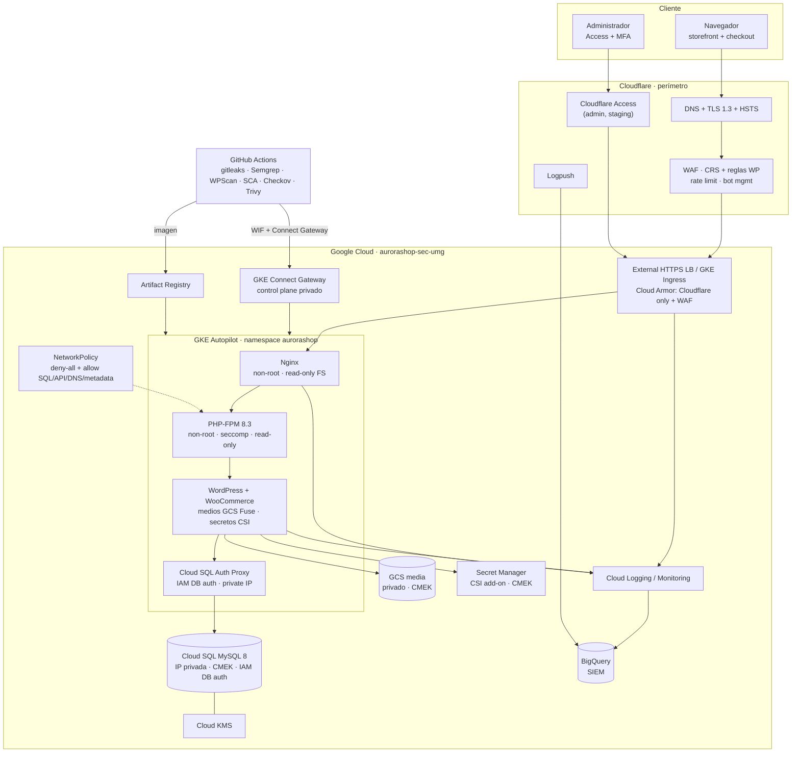

# Arquitectura de seguridad objetivo

Dueño: **Josue** · Revisión: James · Componente de rúbrica 2

> Estado: arquitectura objetivo y código de IaC/manifiestos preparados. No se ha desplegado ni verificado contra GCP; las afirmaciones de comportamiento describen el diseño y requieren evidencia en `evidencias/fase2/` y `fase3/`.

## 1. Principios

1. **Zero Trust:** ninguna petición llega a un pod sin identidad verificada y autorización por recurso; la red no otorga confianza.
2. **Borde primero:** todo el tráfico entra por Cloudflare → GKE Ingress. El origen no es alcanzable directamente.
3. **Inmutabilidad:** contenedor sin escritura, cambios solo por imagen y por pipeline; sin editor de plugins en producción.
4. **Datos cifrados por defecto:** TLS 1.3 en el borde, TLS del proxy de Cloud SQL, CMEK en reposo y secretos solo en Secret Manager.
5. **Menor privilegio verificable:** RBAC de K8s, IAM de GCP y roles de WordPress con justificación escrita.

## 2. Diagramas

Fuentes editables: [contexto C4](diagramas/c4-contexto.mmd), [contenedores C4](diagramas/c4-contenedores.mmd), [flujo de checkout](diagramas/flujo-checkout.mmd) y [cadena de suministro](diagramas/cadena-suministro.mmd). Son diseños objetivos; su exportación y verificación en vivo siguen pendientes.

## 3. Flujo de un checkout

1. El navegador entra por `aurorashop.ancordss.me.uk`; Cloudflare aplica TLS, WAF, rate limit y bot management, y registra en Logpush.
2. El balanceador global recibe solo los rangos publicados de Cloudflare. Cloud Armor aplica WAF administrado y el Ingress dirige al servicio Nginx. El certificado Origin CA de Cloudflare se instala como Secret por un canal seguro.
3. Nginx sirve estáticos y pasa PHP-FPM por localhost. El código WordPress queda de solo lectura; el bucket privado se monta en `wp-content/uploads` mediante GCS Fuse.
4. WordPress se conecta a `127.0.0.1:3306`; Cloud SQL Auth Proxy usa IAM DB Authentication y una IP privada para llegar a MySQL. Una identidad por ambiente tiene permisos de base limitados.
5. Los secretos de aplicación se montan desde Secret Manager mediante el add-on CSI; no se copian a variables de Terraform ni a Secrets de Kubernetes.
6. GKE Connect Gateway da acceso de CI al API de Kubernetes sin habilitar endpoint IP público. Los logs de auditoría GCP y del workload se exportan a BigQuery; James configura Logpush de Cloudflare.

Staging tiene un Ingress y una IP global aparte del storefront demo; James administra su DNS y Cloudflare Access. Ambos quedan detrás de la misma política Cloud Armor con allowlist de Cloudflare.

La validación de nonce, cálculo de precios, webhooks y deduplicación depende del CMS de Horacio. Aún no hay imagen en el repositorio, así que este diseño no afirma que esas funciones ya se ejecuten.

## 4. IAM, RBAC y menor privilegio

| Identidad | Rol(es) | Alcance | Justificación |
|---|---|---|---|
| `sa-gke-workload-{dev,staging,demo}` (Workload Identity) | `roles/cloudsql.client`, `roles/cloudsql.instanceUser`, `roles/storage.objectUser` (su bucket), `roles/secretmanager.secretAccessor` (sus secretos) | Un namespace, base, bucket y secretos por ambiente | Proxy con token efímero; cuenta SQL con CRUD en su base |
| `sa-gh-deployer` | `roles/artifactregistry.writer`, `roles/container.clusterViewer`, `roles/gkehub.viewer`, `roles/gkehub.gatewayEditor` | WIF restringido al repositorio y `main`; RBAC limita namespaces | Publica imágenes y despliega recursos permitidos; sin acceso a Secrets K8s |
| `sa-gh-terraform` (separada) | Permisos de plan y aprovisionamiento definidos por Javier | WIF y environment protegido `infra-apply` | Gestiona IaC después de revisar el plan |
| `sa-backup` | `roles/cloudsql.viewer`, `roles/storage.objectCreator` | Bucket de backups | Respaldo sin leer datos en caliente |
| RBAC K8s: `aurorashop-app` | Sin token API montado; acceso a CSI, GCS y SQL por Workload Identity | Namespace | Sin credenciales duraderas |
| RBAC K8s: `aurorashop-ci-deployer` (CI) | CRUD de Deployment, Service, HPA, PDB, NetworkPolicy, Ingress, BackendConfig y SecretProviderClass | Un namespace por ambiente | No puede leer/modificar Secrets, RBAC ni namespaces |
| Humanos (Javier, Josue, Horacio, Arun) | `roles/viewer` + lectura específica | Proyecto | Auditoría sin capacidad de cambio |
| James | break-glass | Proyecto | Único operador manual |

Prohibido: `roles/owner` o `roles/editor` para cuentas de servicio, claves JSON, tokens de SA montados por defecto, `cluster-admin` para CI, `hostPath`, `privileged: true`, `hostNetwork`.

## 5. Cifrado

| Capa | Mecanismo | Detalle |
|---|---|---|
| Tránsito externo | TLS 1.3 (mín. 1.2), HSTS, cifrados modernos | Cloudflare Edge + Origin CA en el LB; clave instalada fuera de Git |
| Tránsito interno | Cloud SQL Auth Proxy (TLS) por IP privada; APIs GCP por VIP privado; GCS por HTTPS | Sin egress general desde los pods |
| Reposo BD | AES-256 con CMEK | Rotación 90 días; clave administrada con Cloud KMS |
| Reposo objetos | Cifrado por defecto + CMEK en media/backups/logs | Uniform access, versionado y retención |
| Secretos | Secret Manager CSI add-on + CMEK | Auth keys, salts y credenciales sandbox; acceso DB por IAM |
| Backups | Snapshots cifrados con CMEK separada | Restore probado y documentado |

## 6. Controles por capa (7)

| Capa | Controles | Evidencia |
|---|---|---|
| 1 Datos | CMEK, TLS 1.3, Secret Manager, backups cifrados | Terraform, `openssl s_client` |
| 2a Código | Semgrep, revisión, `$wpdb->prepare`, escape en salida | Reportes fase 3 |
| 2b Aplicación | Roles/capacidades, nonces, MFA, autorización por pedido | Pruebas de Horacio |
| 2c Implementación | WPScan, composer/npm audit, plugins fijados por versión | Reportes SCA |
| 2d Perímetro de aplicación | WAF, rate limit, XML-RPC cerrado, uploads sin ejecución | Capturas WAF |
| 3 Host | Imagen distroless/mínima, non-root, read-only, PSA `restricted`, Trivy | `kubectl get`, Trivy |
| 4 Red interna | VPC, subred privada, NetworkPolicy, RBAC, GKE privado, Connect Gateway | Terraform, manifiestos, `kubectl auth can-i` |
| 5 Perímetro cloud | Cloudflare WAF, Cloud Armor, bot mgmt, Access | Reglas y pruebas |
| 6 Física | SLA y certificaciones del proveedor (ISO 27001/SOC 2) | Referencias documentales |
| 7 Políticas | SECURITY.md, reglas de enfrentamiento, revisión cruzada, IAM documentado | Repo + este documento |

## 7. Decisiones y alternativas descartadas

| Decisión | Alternativa descartada | Motivo |
|---|---|---|
| GKE Autopilot | Cloud Run | WordPress necesita FS persistente y procesos PHP; Autopilot reduce administración de nodos y aplica PSA por defecto |
| MySQL administrado | MySQL en pod | Backups, CMEK y parches sin operar la BD |
| Cloudflare delante del LB | Exponer el Ingress | WAF, bot mgmt, Access y Logpush sin costo adicional |
| Bucket GCS + Cloudflare CDN | Plugin de CDN con credenciales | Menos secretos en la app y control de acceso por IAM |
| Cloudflare Access para `wp-admin` | Solo 2FA de WordPress | Segunda barrera antes de tocar la aplicación |
| Imagen propia multi-stage | Imagen oficial `wordpress` | Elimina herramientas de build, fija versiones y permite `read-only` |
| Cloud SQL IAM DB Authentication + Auth Proxy | Contraseña SQL duradera | Identidad IAM por ambiente y token corto, sin clave DB persistente |
| GKE Connect Gateway | Endpoint IP público del API de Kubernetes | Mantiene el endpoint privado y entrega acceso autenticado por IAM/RBAC |

## 8. Decisiones y criterios de verificación

- El origen solo admite rangos publicados de Cloudflare mediante Cloud Armor. Terraform consulta la lista oficial en cada plan; James debe verificar el flujo y la zona antes de encender los registros proxied.
- Medios: bucket privado por ambiente con GCS Fuse y Workload Identity. Medir latencia y comprobar escrituras concurrentes antes de carga.
- Cloud SQL usa Auth Proxy con IAM DB Authentication en IP privada. El SQL runtime recibe CRUD en su base mediante bootstrap; no hay contraseña de aplicación almacenada.
- BigQuery retiene 90 días de tablas. Cloud SQL conserva PITR y siete días de logs de transacción. Verificar sinks reales después del apply.
- Javier revisa presupuesto y cuota antes de aplicar el tier de Cloud SQL.
- Dockerfile, imagen PHP-FPM/Nginx, `wp-config.php` y ruta de salud dependen de Horacio. El despliegue no se marca listo hasta que esos artefactos existan.

## 9. Alcance del API

No se añade un API Gateway dedicado: WooCommerce publica REST bajo `/wp-json/wc/v3/*` en el mismo host. Cloudflare WAF/Access, Cloud Armor y los controles de autorización del CMS protegen esa ruta; las reglas específicas se coordinan con James y Horacio.

Referencias técnicas: [GKE Connect Gateway](https://docs.cloud.google.com/kubernetes-engine/enterprise/multicluster-management/gateway/using), [Cloud SQL IAM Authentication](https://docs.cloud.google.com/sql/docs/mysql/iam-authentication), [Secret Manager CSI en GKE](https://docs.cloud.google.com/secret-manager/docs/secret-manager-managed-csi-component), [GCS Fuse CSI en GKE](https://docs.cloud.google.com/kubernetes-engine/docs/how-to/cloud-storage-fuse-csi-driver-setup), [rangos IP de Cloudflare](https://developers.cloudflare.com/fundamentals/concepts/cloudflare-ip-addresses/).
