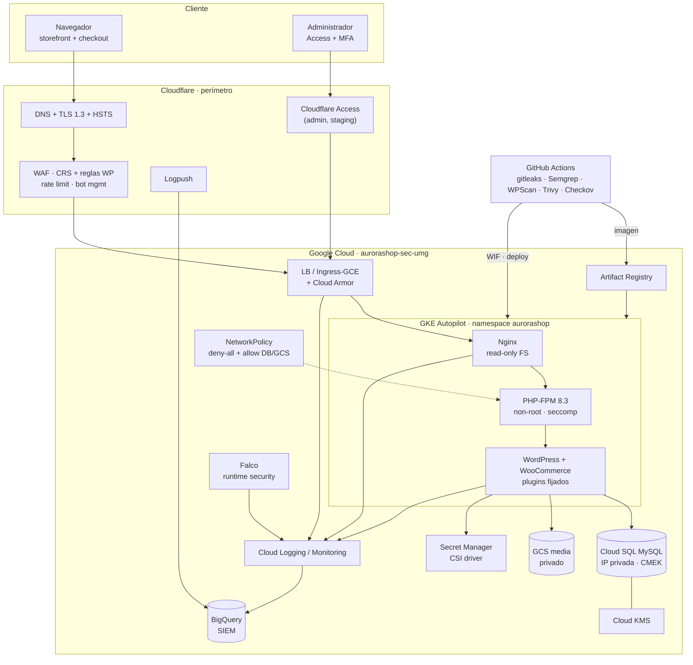

# Arquitectura de seguridad objetivo

Dueño: **Josue** · Revisión: James · Componente de rúbrica 2

## 1. Principios

1. **Zero Trust:** ninguna petición llega a un pod sin identidad verificada y autorización por recurso; la red no otorga confianza.
2. **Borde primero:** todo el tráfico entra por Cloudflare → GKE Ingress. El origen no es alcanzable directamente.
3. **Inmutabilidad:** contenedor sin escritura, cambios solo por imagen y por pipeline; sin editor de plugins en producción.
4. **Datos cifrados por defecto:** TLS 1.3 en tránsito, CMEK en reposo, secretos solo en Secret Manager.
5. **Menor privilegio verificable:** RBAC de K8s, IAM de GCP y roles de WordPress con justificación escrita.

## 2. Diagrama

## 3. Flujo de un checkout

1. El navegador entra por `aurorashop.ancordss.me.uk`; Cloudflare aplica TLS, WAF, rate limit y bot management, y registra en Logpush.
2. El LB aplica Cloud Armor y entrega al Ingress; NetworkPolicy limita el tráfico del pod a MySQL, GCS y DNS.
3. Nginx sirve estáticos y pasa PHP-FPM; WordPress valida nonce y sesión; WooCommerce calcula el total en servidor (nunca confía en el precio del cliente).
4. La creación del pedido usa una transacción SQL; el cupón se revalida dentro de la transacción para evitar doble uso.
5. El pago se delega a la pasarela sandbox; el webhook se valida por firma y se deduplica por `event_id`.
6. Se registra auditoría (quién, qué pedido, monto, IP, resultado) que llega a BigQuery; la respuesta no expone trazas.

## 4. IAM, RBAC y menor privilegio

| Identidad | Rol(es) | Alcance | Justificación |
|---|---|---|---|
| `sa-gke-workload` (Workload Identity) | `roles/cloudsql.client`, `roles/storage.objectViewer` (media), `roles/secretmanager.secretAccessor` (`aurorashop-*`) | Namespace `aurorashop` | Solo lo que el CMS necesita |
| `sa-gh-deployer` | `roles/container.developer`, `roles/artifactregistry.writer`, `roles/iam.serviceAccountUser` | Proyecto, WIF condicionado a repo/rama | Despliegue automatizado |
| `sa-backup` | `roles/cloudsql.viewer`, `roles/storage.objectCreator` | Bucket de backups | Respaldo sin leer datos en caliente |
| RBAC K8s: `aurorashop-app` | `get/list/watch` en ConfigMap/Secret del namespace | Namespace | Sin acceso a otros namespaces ni a la API de administración |
| RBAC K8s: `aurorashop-deployer` (CI) | `edit` en el namespace | Namespace | Despliegue acotado |
| Humanos (Javier, Josue, Horacio, Arun) | `roles/viewer` + lectura específica | Proyecto | Auditoría sin capacidad de cambio |
| James | break-glass | Proyecto | Único operador manual |

Prohibido: `roles/owner` o `roles/editor` para cuentas de servicio, tokens de SA montados por defecto, `cluster-admin` para CI, `hostPath`, `privileged: true`, `hostNetwork`.

## 5. Cifrado

| Capa | Mecanismo | Detalle |
|---|---|---|
| Tránsito externo | TLS 1.3 (mín. 1.2), HSTS, cifrados modernos | Cloudflare Edge + Origin CA |
| Tránsito interno | Cloud SQL por IP privada; GCS por HTTPS | Sin tráfico en claro en la VPC |
| Reposo BD | AES-256 con CMEK | Rotación 90 días; clave por ambiente |
| Reposo objetos | Cifrado por defecto + CMEK en media/backups | Uniform access, versionado, retención |
| Secretos | Secret Manager + CSI driver, CMEK | Sin secretos en env persistentes ni en el repo |
| Backups | Snapshots cifrados con CMEK separada | Restore probado y documentado |

## 6. Controles por capa (7)

| Capa | Controles | Evidencia |
|---|---|---|
| 1 Datos | CMEK, TLS 1.3, Secret Manager, backups cifrados | Terraform, `openssl s_client` |
| 2a Código | Semgrep, revisión, `$wpdb->prepare`, escape en salida | Reportes fase 3 |
| 2b Aplicación | Roles/capacidades, nonces, MFA, autorización por pedido | Pruebas de Horacio |
| 2c Implementación | WPScan, composer/npm audit, plugins fijados por versión | Reportes SCA |
| 2d Perímetro de aplicación | WAF, rate limit, XML-RPC cerrado, uploads sin ejecución | Capturas WAF |
| 3 Host | Imagen distroless/mínima, non-root, read-only, PSA `restricted`, Trivy | `kubectl get`, Trivy |
| 4 Red interna | VPC, subred privada, NetworkPolicy, RBAC, GKE privado | Manifiestos, `kubectl auth can-i` |
| 5 Perímetro cloud | Cloudflare WAF, Cloud Armor, bot mgmt, Access | Reglas y pruebas |
| 6 Física | SLA y certificaciones del proveedor (ISO 27001/SOC 2) | Referencias documentales |
| 7 Políticas | SECURITY.md, reglas de enfrentamiento, revisión cruzada, IAM documentado | Repo + este documento |

## 7. Decisiones y alternativas descartadas

| Decisión | Alternativa descartada | Motivo |
|---|---|---|
| GKE Autopilot | Cloud Run | WordPress necesita FS persistente y procesos PHP; Autopilot reduce administración de nodos y aplica PSA por defecto |
| MySQL administrado | MySQL en pod | Backups, CMEK y parches sin operar la BD |
| Cloudflare delante del LB | Exponer el Ingress | WAF, bot mgmt, Access y Logpush sin costo adicional |
| Bucket GCS + Cloudflare CDN | Plugin de CDN con credenciales | Menos secretos en la app y control de acceso por IAM |
| Cloudflare Access para `wp-admin` | Solo 2FA de WordPress | Segunda barrera antes de tocar la aplicación |
| Imagen propia multi-stage | Imagen oficial `wordpress` | Elimina herramientas de build, fija versiones y permite `read-only` |

## 8. Pendientes de decisión

- [ ] ¿Cloudflare Authenticated Origin Pull o restricción por rangos de Cloudflare en el LB? (James + Josue, 24-nov)
- [ ] Estrategia de media: subida directa a GCS con URL firmada o volumen persistente + sync.
- [ ] Tamaño de Cloud SQL y pooling (Proxy o conector) para 4 pods PHP.
- [ ] Retención: 30 días en Logging, 90 en BigQuery (costo).
