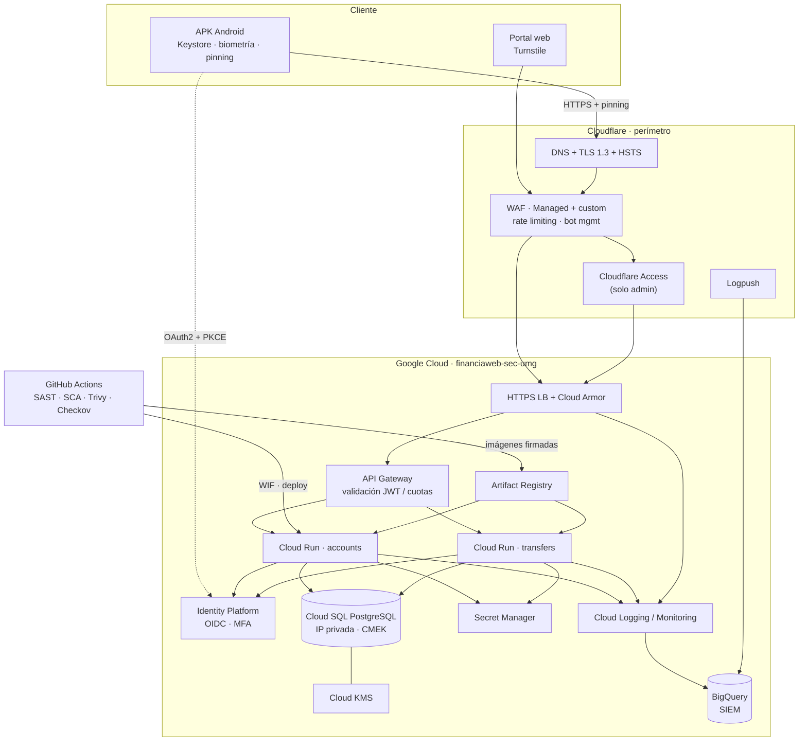

# Arquitectura de seguridad objetivo

Dueño: **Josue** · Revisión: James · Componente de rúbrica 2

## 1. Principios

1. **Zero Trust:** ninguna petición llega a un servicio sin identidad verificada y autorización por recurso; la red no otorga confianza.
2. **Borde primero:** todo el tráfico entra por Cloudflare → GCP LB. El origen no es alcanzable directamente.
3. **Un solo camino de despliegue:** pipeline con WIF; sin credenciales estáticas, sin cambios manuales en `demo`.
4. **Datos cifrados por defecto:** TLS 1.3 en tránsito, CMEK en reposo, secretos solo en Secret Manager.
5. **Menor privilegio verificable:** cada identidad tiene su rol mínimo y su justificación escrita.

## 2. Diagrama

## 3. Flujo de una operación crítica (transferencia)

1. El APK obtiene un token OIDC (Authorization Code + PKCE) de Identity Platform; el token se guarda en Keystore.
2. La app llama `POST https://api.financiaweb.ancordss.me.uk/v1/transfers` con `Authorization: Bearer`.
3. Cloudflare valida TLS, aplica WAF y rate limiting, registra en Logpush.
4. El LB aplica Cloud Armor y entrega a API Gateway, que valida firma, `iss`, `aud`, `exp` y scopes.
5. `transfers` revalida el token, verifica que la cuenta origen pertenezca al `sub`, valida monto y beneficiario, y ejecuta la transacción en una transacción SQL con bloqueo.
6. Se escribe un registro de auditoría inmutable (quién, qué, cuándo, desde dónde, resultado) que llega a BigQuery.
7. La respuesta no expone identificadores internos ni trazas.

## 4. IAM de menor privilegio

| Identidad | Rol(es) | Alcance | Justificación |
|---|---|---|---|
| `sa-run-accounts` | `roles/cloudsql.client`, `roles/secretmanager.secretAccessor` (secretos `accounts-*`) | Servicio `accounts` | Solo necesita BD y sus secretos |
| `sa-run-transfers` | `roles/cloudsql.client`, `roles/secretmanager.secretAccessor` (secretos `transfers-*`) | Servicio `transfers` | Aislamiento entre servicios |
| `sa-gh-deployer` | `roles/run.admin`, `roles/artifactregistry.writer`, `roles/iam.serviceAccountUser` | Proyecto, con condición de repo/rama en WIF | Despliegue automatizado |
| `sa-sql-backup` | `roles/cloudsql.viewer`, `roles/storage.objectCreator` | Bucket de backups | Respaldo sin acceso a datos en caliente |
| Humans (Javier, Josue, Horacio, Arun) | `roles/viewer` + roles de lectura específicos | Proyecto | Auditoría sin capacidad de cambio |
| James | break-glass | Proyecto | Único operador manual |

Prohibido: `roles/owner` o `roles/editor` para cuentas de servicio, claves JSON, cuentas de servicio con roles a nivel organización.

## 5. Cifrado

| Capa | Mecanismo | Detalle |
|---|---|---|
| Tránsito externo | TLS 1.3 (mínimo 1.2), HSTS, cifrados modernos | Certificado de Cloudflare; Origin CA hacia GCP |
| Tránsito interno | TLS entre LB → servicios; IP privada para SQL | Sin tráfico en claro dentro de la VPC |
| Reposo en BD | AES-256 con CMEK en Cloud KMS | Rotación automática 90 días; clave separada por ambiente |
| Reposo en objetos | Cifrado por defecto + CMEK en buckets críticos | Uniform access, versionado, retención |
| Secretos | Secret Manager con CMEK, versiones y auditoría | Sin secretos en variables de entorno persistentes |
| Dispositivo móvil | Android Keystore + EncryptedSharedPreferences | Token de refresh cifrado; sin datos sensibles en logs |
| Respaldos | Snapshots cifrados con CMEK separada | Prueba de restauración documentada |

## 6. Controles por capa (las 7)

| Capa | Controles implementados | Evidencia |
|---|---|---|
| 1 Datos | CMEK, TLS 1.3, Keystore, Argon2id, enmascaramiento de logs | Terraform, capturas, `openssl s_client` |
| 2a Código | Semgrep, revisión, consultas parametrizadas, validación de esquema | Reportes en `evidencias/fase3/` |
| 2b Aplicación | OAuth2 + PKCE, MFA, autorización por recurso, rotación de refresh | Pruebas de Horacio |
| 2c Implementación | Dependency-Check/Snyk, pin de versiones, lockfiles | Reportes SCA |
| 2d Perímetro de aplicación | API Gateway con JWT, esquema OpenAPI, cuotas, CORS cerrado | Config y pruebas |
| 3 Host | Imágenes distroless, Trivy, sin shell, usuario no root, parches | Reporte Trivy |
| 4 Red interna | VPC, subred privada, firewall rules restrictivas, conector serverless | `terraform plan`, Checkov |
| 5 Perímetro cloud | Cloudflare WAF, Cloud Armor, rate limit, bot mgmt, DDoS | Capturas y reglas |
| 6 Física | SLA y certificaciones del proveedor (ISO 27001/SOC 2) | Referencias documentales |
| 7 Políticas | SECURITY.md, reglas de enfrentamiento, revisión cruzada, IAM documentado | Repo + este documento |

## 7. Decisiones y alternativas descartadas

| Decisión | Alternativa descartada | Motivo |
|---|---|---|
| Cloudflare delante de GCP LB | Exponer Cloud Run directamente | Necesitamos WAF, bot mgmt y Zero Trust sin costo |
| API Gateway para validar JWT | Validar solo en cada servicio | Defensa en profundidad y cuotas centralizadas |
| Cloud Run | GKE | Menos superficie que hardening de clúster; el curso evalúa contenedores igual con Trivy |
| Workload Identity Federation | Claves JSON de SA | Elimina el secreto de larga vida |
| Identity Platform | Auth0 free | Ya está en GCP y permite MFA y OIDC sin costo inicial |
| Pinning de CA intermedia + backup pin | Pinning de hoja | Cloudflare rota certificados; la hoja rompería la app |

## 8. Pendientes de decisión

- [ ] ¿Cloudflare Authenticated Origin Pull (mTLS) o restricción por rangos IP en el LB? (James + Josue, 24-nov)
- [ ] Tamaño de Cloud SQL y política de conexiones (pooling en el servicio).
- [ ] Si Identity Platform exige dominio verificado, usar la opción de dominio propio en Cloudflare.
- [ ] Retención de logs: 30 días en Logging, 90 en BigQuery (costo).
