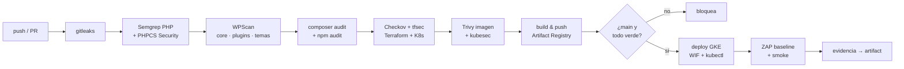

# Pipeline CI/CD seguro

Dueño: **Josue** · Componente de rúbrica 2 · Estado: especificación (implementación en `.github/workflows/` por Josue)

## 1. Objetivo

Ningún artefacto llega a GKE sin pasar por secretos, SAST, SCA de plugins, contenedor, IaC y manifiestos; y el despliegue usa identidad federada, sin claves estáticas.

## 2. Etapas

| # | Job | Herramienta | Falla el build | Salida |
|---|---|---|---|---|
| 1 | `secrets` | gitleaks | sí, cualquier hallazgo | SARIF/JSON |
| 2 | `sast` | Semgrep (`p/php`, `p/owasp-top-ten`, `p/secrets`) | sí en ERROR | SARIF |
| 3 | `sca-cms` | WPScan (núcleo, plugins, tema) con token API | sí CVE ≥ 7.0 en componente en uso | JSON |
| 4 | `sca-deps` | `composer audit`, `npm audit` | sí high/critical con fix | reporte |
| 5 | `iac` | Checkov + tfsec (Terraform y manifiestos) | sí HIGH/CRITICAL | SARIF |
| 6 | `container` | Trivy (`os,library`) + kubesec | sí CRITICAL con fix | tabla |
| 7 | `build` | docker buildx + push a Artifact Registry (digest) | sí | imagen con SHA |
| 8 | `deploy` | `google-github-actions/auth` (WIF) + `kubectl rollout` | sí | revisión desplegada |
| 9 | `smoke` | ZAP baseline + `curl` a `/shop` y `/my-account` | sí 5xx o hallazgo alto | HTML |

## 3. Reglas

- `pull_request` corre jobs 1–6; `push` a `main` corre todo.
- `permissions: contents: read`; `id-token: write` solo en `deploy`.
- Prohibido `pull_request_target` con checkout del PR (vector T-47). Toda acción de terceros pinneada por SHA (T-49).
- Secretos de CI: `GCP_WIF_PROVIDER`, `GCP_SERVICE_ACCOUNT`, `WPSCAN_TOKEN`. Nada se imprime; `set -x` prohibido donde haya secretos.
- Caché de dependencias permitido; caché de resultados de seguridad, no.
- Reportes archivados 30 días y copiados a `evidencias/fase3/`.
- Renovate/Dependabot semanal para plugins/composer; el merge a producción sigue siendo por PR con pipeline.

## 4. Evidencia para la rúbrica

| Criterio | Evidencia |
|---|---|
| SAST integrado | PR con hallazgo Semgrep en rojo y el mismo PR en verde tras el fix |
| SCA de plugins | Tabla WPScan: plugin, versión, CVE, versión corregida, commit del bump |
| SCA de dependencias | `composer audit` antes/después |
| IaC + K8s | Checkov antes (N fallos) / después (0 altos), con el diff |
| Contenedor | Trivy antes/después del cambio de base; kubesec |
| Despliegue | Log del job con WIF + `kubectl rollout status` + digest de la imagen |

## 5. Métricas

- Tiempo total objetivo < 12 min (build de imagen incluido).
- Falsos positivos documentados por herramienta; cada supresión con comentario y justificación.
- Fallo por infraestructura se reintenta; fallo por hallazgo se corrige, no se reintenta.
