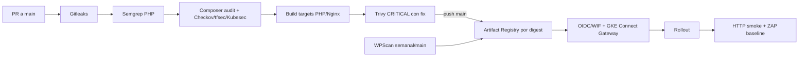

# Pipeline CI/CD seguro

Dueño: **Josue** · Componente de rúbrica 2 · Estado: workflows preparados; sin ejecución remota documentada.

## 1. Flujo

La definición ejecutable está en `.github/workflows/security-ci.yml`; el plan y apply controlado de infraestructura está en `.github/workflows/terraform.yml`.

## 2. Gates implementados

| Job | Herramienta | Falla el job | Salida |
|---|---|---|---|
| `secrets` | Gitleaks, historial completo | Cualquier secreto encontrado | SARIF |
| `sast` | Semgrep PHP, OWASP Top 10 y secrets | Hallazgo marcado ERROR | SARIF |
| `wpscan` | WPScan contra storefront activo | Token ausente, error de escaneo o CVSS ≥ 7.0 | JSON + resumen |
| `sca-deps` | Composer audit; npm audit si existe lockfile JS | Vulnerabilidad de dependencias o lockfile faltante | JSON |
| `iac` | Checkov, tfsec y Kubesec | Checkov HIGH/CRITICAL o tfsec HIGH/CRITICAL | SARIF/JSON |
| `container` | Docker targets PHP/Nginx y Trivy | Falta Dockerfile/targets o CRITICAL con fix | JSON por imagen |
| `publish` | Docker + Artifact Registry | Solo corre con todos los gates verdes en `main` | digest por imagen |
| `deploy` | GitHub OIDC/WIF + GKE Connect Gateway | Falla apply de manifiestos o rollout | log de rollout |
| `smoke` | `curl` y ZAP baseline | `/shop` o `/my-account` no responde 200; falla ZAP | HTML/JSON |

Los pull requests ejecutan los análisis de código, dependencias e infraestructura y construyen/escanean imágenes. WPScan consulta el storefront desplegado, por eso corre en `push main`, ejecución manual y agenda semanal; no se presenta como análisis del código no desplegado del PR. Publicación y despliegue ocurren en `main` solamente. La agenda semanal actualiza el inventario WPScan sin republicar imágenes.

## 3. Identidad y permisos

- `contents: read` por defecto. `id-token: write` solo en publicación, despliegue y Terraform remoto.
- GCP usa WIF; no se cargan claves JSON. `GCP_WIF_PROVIDER` y `GCP_SERVICE_ACCOUNT` pertenecen a la identidad de deploy creada por Javier. Terraform usa `TF_WIF_PROVIDER` y `TF_SERVICE_ACCOUNT` separados.
- El deploy publica únicamente en Artifact Registry y llega al clúster por Connect Gateway; RBAC limita la identidad CI a los namespaces y recursos de aplicación.
- `terraform.yml` ejecuta validación sin credenciales en PR; plan remoto en `main`; `apply` solo con `workflow_dispatch`, branch `main` y environment protegido `infra-apply`.
- Acciones de GitHub están fijadas por SHA completo. Herramientas de análisis usan versiones fijadas en la imagen.

## 4. Dependencias y preparación requerida

- Javier configura el bucket remoto y la variable `TF_STATE_BUCKET`; WIF de plan/apply y deploy; secretos WIF y el environment `infra-apply` con aprobador.
- Añadir `WPSCAN_TOKEN` como secreto y mantener publicada la URL demo para el análisis vivo.
- Horacio debe entregar `cms/docker/Dockerfile` con targets `php-runtime` y `nginx-runtime`; el job de contenedor falla de forma explícita hasta que exista.
- El checkout PHP tiene un manifiesto runtime mínimo. Horacio debe compartir las bibliotecas PHP y JavaScript que realmente use para agregarlas a Composer/npm y generar locks; no se inventan paquetes.
- El bootstrap de GKE, namespaces, RBAC, Workload Identity y certificado TLS de Cloudflare deben existir antes del primer despliegue.

## 5. Evidencia

Los reportes de cada ejecución se conservan 30 días como artifacts de GitHub Actions. Para el informe deben descargarse y registrarse con ID de ejecución en `evidencias/fase3/`; este repositorio todavía no contiene resultados de scans ni logs de despliegue. No se atribuyen conteos de hallazgos sin ejecución.

## 6. Riesgo y criterio de cierre

Un análisis en rojo se corrige o se triagea con evidencia; no se vuelve a ejecutar para ocultar el hallazgo. El tiempo objetivo es menor a 12 minutos una vez que existan las imágenes, el endpoint demo y los accesos. La política de rama debe exigir los checks de CI y una revisión PR; no se documenta como activa hasta que GitHub confirme el cambio.
