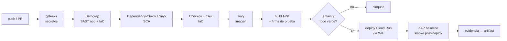

# Pipeline CI/CD seguro

Dueño: **Josue** · Componente de rúbrica 2 · Estado: especificación (implementación en `.github/workflows/` por Josue)

## 1. Objetivo

Que ningún artefacto llegue a `demo` sin pasar por análisis estático, de dependencias, de secretos, de contenedor y de IaC; y que el despliegue use identidad federada, no claves.

## 2. Etapas

| # | Job | Herramienta | Falla el build | Salida |
|---|---|---|---|---|
| 1 | `secrets` | gitleaks | sí, cualquier hallazgo | reporte SARIF/JSON |
| 2 | `sast` | Semgrep (`p/owasp-top-ten`, `p/python` o `p/javascript`, `p/secrets`) | sí en severidad ERROR | SARIF a Security tab |
| 3 | `sca` | OWASP Dependency-Check o Snyk CLI | sí CVSS ≥ 7 con fix disponible | reporte HTML |
| 4 | `iac` | Checkov + tfsec | sí hallazgo HIGH/CRITICAL | reporte JSON |
| 5 | `container` | Trivy (imagen e `os,library`) | sí CRITICAL con fix | tabla en el job |
| 6 | `apk` | Gradle/Flutter + `apksigner verify` | sí firma inválida | artifact `.apk` |
| 7 | `deploy` | `google-github-actions/auth` (WIF) + `deploy-cloudrun` | sí | revisión desplegada |
| 8 | `smoke` | ZAP baseline + `curl` a `/health` | sí 5xx o hallazgo alto | HTML |

## 3. Reglas

- `pull_request` corre jobs 1–6; `push` a `main` corre todo, incluido deploy.
- `permissions: contents: read` por defecto; `id-token: write` solo en `deploy`.
- Prohibido `pull_request_target` con checkout del PR: es el vector de T-50.
- Secretos de CI: solo los estrictamente necesarios (`GCP_WIF_PROVIDER`, `GCP_SERVICE_ACCOUNT`, `APK_KEYSTORE_B64` + password). Ninguno se imprime; `set -x` prohibido en pasos con secretos.
- Caché de dependencias permitido; caché de resultados de seguridad no.
- Todo reporte se archiva como artifact con retención 30 días y se copia a `evidencias/fase3/` para el informe.
- Dependencias: lockfile obligatorio; Renovate/Dependabot semanal (opcional, sin bloquear).

## 4. Evidencia para la rúbrica

| Criterio | Evidencia concreta |
|---|---|
| SAST integrado | Captura de un PR con hallazgo de Semgrep y el check en rojo; luego el mismo PR en verde tras el fix |
| SCA integrado | Lista de CVEs detectados, versión afectada, versión corregida y commit del bump |
| IaC | `checkov` antes (N fallos) y después (0 altos), con el diff de Terraform |
| Contenedor | Trivy antes/después del cambio de base image |
| Despliegue | Log del job `deploy` con WIF y la revisión de Cloud Run con el commit SHA |

## 5. Métricas del pipeline

- Tiempo total objetivo < 10 min (sin contar build de APK).
- Tasa de falsos positivos documentada por herramienta; cada supresión lleva comentario y justificación en el archivo de configuración.
- Un job que falla por infraestructura se reintenta; uno que falla por hallazgo no se reintenta, se corrige.
