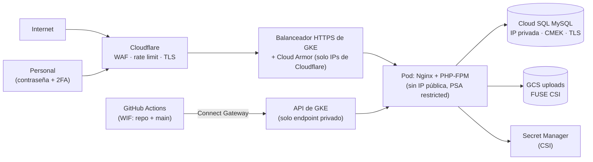

# Superficie de ataque y perímetro del software

Dueño: **Horacio** · Verificación: James (borde) · Componente de rúbrica 3 · Issue #47 · Corte: 2026-11-27

## 1. Zonas de confianza

Regla verificada: nada fuera de Cloudflare llega al pod (Cloud Armor deniega el resto), el pod no tiene IP pública y su salida está limitada por NetworkPolicy a DNS, Cloud SQL (3307), APIs de Google por la VIP restringida y el metadata server.

## 2. Inventario de exposición (verificado en producción)

| Host / ruta | Servicio | Autenticación | Datos | Riesgo | Control | Resultado |
|---|---|---|---|---|---|---|
| `aurorashop.../` | Storefront | — | catálogo | scraping | rate limit, bot management | 200 |
| `/wp-login.php` | Login | contraseña + 2FA (personal) | cuentas | fuerza bruta | rate limit Cloudflare + Nginx, bloqueo, 2FA | 429 desde el 3.er GET seguido |
| `/xmlrpc.php` | XML-RPC | — | cuentas | amplificación | Nginx + WordPress | 403 |
| `/wp-json/wp/v2/users` y `?rest_route=/wp/v2/users` | REST núcleo | — | usuarios | enumeración | WAF + mu-plugin (#44) | 403 / 401 |
| `/wp-json/` | Índice REST | — | lista de rutas | reconocimiento | aceptado (estándar de WordPress) | 200 |
| `/wp-json/wc/v3/*` | REST WooCommerce | claves de API | pedidos, clientes | IDOR | autenticación + permisos | 401 |
| `/wp-json/wc/store/v1/*` | Store API (carrito) | nonce | carrito, productos | manipulación | nonce + recálculo en servidor | productos 200; carrito sin nonce 401 |
| `/wp-admin/*` | Administración | sesión + 2FA + Access | todo | toma de control | Access en `admin-` desde 2026-11-27 | 302 al login |
| `admin-aurorashop.../` | Administración | Cloudflare Access | todo | toma de control | aplicación Access con política Allow | 302 a `alzentis.cloudflareaccess.com` |
| `/wp-content/uploads/*` | Media | — | imágenes, PDF | shell | sin ejecución ni listado | `.php` 403; listado 403 |
| `/wp-content/plugins/*/readme.txt` y `*.php` | Metadatos/código | — | versión | fingerprint | Nginx | 403 |
| `/?author=1`, `/author/<slug>/`, sitemap de usuarios | Enumeración | — | usuarios | fuerza bruta dirigida | mu-plugin (#44) | 404 |
| `/readme.html`, `.git/`, `.env`, `*.bak`, `debug.log`, instalador | Archivos sensibles | — | versión, secretos | fuga | Nginx | 403 |
| `/wp-cron.php` | Tareas programadas | — | — | carga | pendiente CronJob (P-12) | 200 |
| `checkout/order-received/<id>` | Post-compra | sesión o clave | pedido | IDOR | propiedad del pedido | sin datos ajenos (A01-2/3) |
| `staging-aurorashop...` | Réplica | — | — | registro DNS huérfano | registro eliminado el 2026-11-27 | no resuelve |
| IP del balanceador (directo) | Origen | — | app | bypass del WAF | Cloud Armor: solo rangos de Cloudflare | 403 con Host; 404 sin Host |
| API de GKE | Plano de control | IAM | clúster | control total | endpoint privado, sin acceso externo por DNS | sin endpoint público |

## 3. Procedimiento de mapeo

1. Hosts del proyecto: `aurorashop`, `admin-aurorashop` (Ingress) y `staging-aurorashop` (DNS).
2. Rutas: 28 rutas sensibles con `curl` contra producción, más el HTML y el índice REST.
3. Origen directo: `curl --resolve` hacia la IP del balanceador con y sin `Host` (sin pasar por Cloudflare).
4. TLS: `openssl s_client` con TLS 1.0, 1.2 y 1.3 contra el borde.
5. Configuración: `gcloud container clusters describe`, `gcloud compute security-policies describe`, `gcloud compute firewall-rules list`, `kubectl get ingress,svc`.
6. Cada diferencia con lo documentado es un hallazgo `P-NN`.

No se corrió `nmap`: el único servicio público es el balanceador HTTPS de Google detrás de Cloudflare; la configuración de firewall y Cloud Armor se leyó directamente de GCP.

## 4. Hallazgos de perímetro

| ID | Elemento | Expuesto | Esperado | Real | Estado | Responsable |
|---|---|---|---|---|---|---|
| P-01 | Origen del balanceador | Internet | 403 sin Cloudflare | 403 (Cloud Armor, regla por defecto *deny*) | ✅ cumple | — |
| P-02 | `xmlrpc.php` | Internet | 403/405 | 403 | ✅ cumple | — |
| P-03 | `wp/v2/users` (ambas rutas) | Internet | 401/403 | 403 / 401 | ✅ cumple | — |
| P-04 | `readme.html` / `?ver=` / generator | Internet | sin versión | 403; `ver` opaco; sin generator | ✅ cumple | — |
| P-05 | `staging` | Internet | Access | no existe réplica (ver P-10) | n/a | — |
| P-06 | API de GKE | Internet | privada | `enablePublicEndpoint: false`, DNS sin tráfico externo | ✅ cumple | — |
| P-07 | TLS en el borde | Internet | mínimo TLS 1.2 | TLS 1.0/1.1 rechazados, TLS 1.2 OK (2026-11-27) | ✅ cumple | — |
| P-08 | HSTS | Internet | `Strict-Transport-Security` | `max-age=31536000` (2026-11-27) | ✅ cumple | — |
| P-09 | `admin-aurorashop` y `/wp-admin` | Internet | Cloudflare Access | Access en `admin-`; 302 a `alzentis.cloudflareaccess.com` (2026-11-27) | ✅ cumple | — |
| P-10 | `staging-aurorashop` | Internet | sin registro o con Access | registro DNS eliminado; no resuelve (2026-11-27) | ✅ cumple | — |
| P-11 | Red `default` de GCP | Internet | sin reglas abiertas | SSH 22 y RDP 3389 desde `0.0.0.0/0` (sin VMs en esa red) | ⚠️ abierto | Josue/James (borrar la red `default` en Terraform) |
| P-12 | `wp-cron.php` | Internet | no público | 200 | ⚠️ aceptado temporal | Horacio (CronJob + `DISABLE_WP_CRON`) |
| P-13 | Rama `main` en GitHub | Equipo | PR obligatorio | sin *branch protection* | ⚠️ abierto | Josue (regla de rama) |

## 5. Evidencia

`evidencias/fase2/owasp-abuso-superficie-2026-11-26.md`: códigos HTTP por ruta, salida de `openssl s_client`, prueba del origen directo, `gcloud`/`kubectl` de clúster, Cloud Armor y firewall. La IP del balanceador y las del cliente se redactan.
