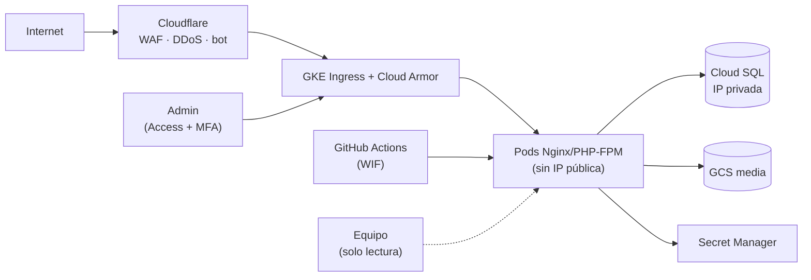

# Superficie de ataque y perímetro del software

Dueño: **Horacio** · Verificación: James (borde) · Componente de rúbrica 3

## 1. Zonas de confianza

Regla: nada fuera de Cloudflare/LB acepta tráfico de Internet; el pod no acepta conexiones salvo a MySQL, GCS y DNS.

## 2. Inventario de exposición

| Host / ruta | Servicio | Autenticación | Datos | Riesgo | Control |
|---|---|---|---|---|---|
| `aurorashop.../` | Storefront | — | catálogo | scraping | rate limit, bot mgmt |
| `/wp-login.php` | Login | credenciales | cuentas | fuerza bruta | 10 req/min, 2FA, WAF |
| `/xmlrpc.php` | XML-RPC | credenciales | cuentas | amplificación | bloqueado (403/405) |
| `/wp-json/wp/v2/users` | REST núcleo | — | usuarios | enumeración | 403 para no autenticados |
| `/wp-json/wc/v3/*` | REST WooCommerce | consumer key/secret | pedidos, clientes | IDOR | auth + permisos + rate limit |
| `/wp-admin/*` | Administración | sesión + Access | todo | toma de control | Access + MFA + rate limit |
| `/wp-content/uploads/*` | Media | — | imágenes, PDFs | upload shell | sin ejecución PHP |
| `/wp-content/plugins/*/readme.txt` | Metadatos | — | versión | fingerprint | WAF + sin exposición |
| `/?author=1` | Enumeración | — | usuarios | fuerza bruta dirigida | bloqueado en WAF |
| `staging.aurorashop...` | Réplica | Access | todo | pruebas sobre datos | Access + `noindex` |
| Ingress IP / `*.run.app` n.a. | Origen | — | app | bypass de WAF | solo rangos Cloudflare |
| GKE API | Control | IAM | clúster | control total | endpoint privado |
| `checkout/order-received` | Post-compra | sesión | pedidos ajenos | IDOR | verificación de propiedad |

## 3. Procedimiento de mapeo

1. Enumerar hosts desde los registros DNS del proyecto (solo los propios).
2. `nmap -sV -Pn --top-ports 1000` a cada host; registrar servicios y versiones.
3. Probar el origen directo: el LB debe rechazar peticiones sin Host de Cloudflare; documentar respuesta.
4. Enumerar rutas con WPScan (`vp,vt,u`), `ffuf` (lista corta) y el HTML del storefront.
5. Verificar métodos (`OPTIONS`) y respuestas de `wp-json`.
6. Comparar con lo documentado: cada diferencia es un hallazgo `H-NN`.

## 4. Hallazgos de perímetro

| ID | Elemento | Expuesto | Esperado | Real | Estado |
|---|---|---|---|---|---|
| P-01 | Origen del LB | Internet | 403 sin Cloudflare | pendiente | por verificar |
| P-02 | `xmlrpc.php` | Internet | 403/405 | pendiente | por verificar |
| P-03 | `wp-json/wp/v2/users` | Internet | 403 | pendiente | por verificar |
| P-04 | `readme.html` / `?ver=` | Internet | sin versión | pendiente | por verificar |
| P-05 | `staging` | Internet | Access | pendiente | por verificar |
| P-06 | GKE API | Internet | privada | pendiente | por verificar |

## 5. Evidencia

`nmap` textual, `curl -I` por host, captura del bloqueo del origen, `kubectl get ingress`, listado de reglas del firewall de Terraform. Sin capturas con IPs internas completas: se redactan los dos últimos octetos.
