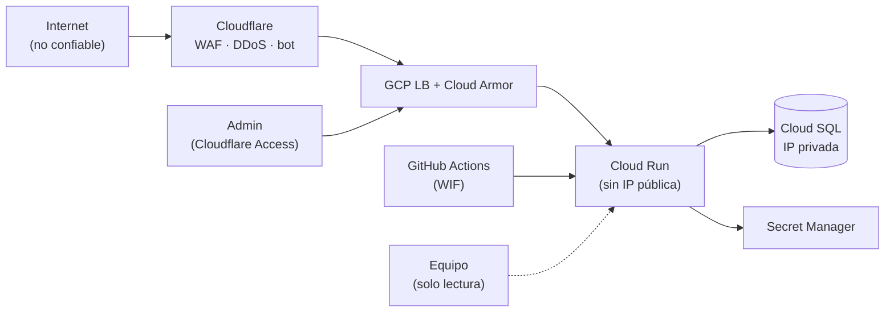

# Superficie de ataque y perímetro del software

Dueño: **Horacio** · Verificación: James (borde) · Componente de rúbrica 3

## 1. Zonas de confianza

Regla: ningún elemento fuera de Cloudflare/LB debe aceptar tráfico de Internet.

## 2. Inventario de exposición

| Host / puerto | Servicio | Autenticación | Datos que expone | Riesgo | Control |
|---|---|---|---|---|---|
| `financiaweb.ancordss.me.uk:443` | Portal web | sesión + Turnstile | páginas públicas, login | XSS, bot | WAF, CSP |
| `api.financiaweb.ancordss.me.uk:443` | API REST | JWT (OIDC) | cuentas, movimientos | IDOR, abuso | API Gateway, WAF, rate limit |
| `api.../v1/auth/*` | Login/registro | — | credenciales | fuerza bruta | 10 req/min, MFA |
| `admin.financiaweb...:443` | Consola admin | Access (correo del grupo) | datos de todos | acceso privilegiado | Zero Trust, MFA |
| `api.../v1/webhooks/*` | Webhooks (demo) | HMAC | eventos | SSRF | allowlist de destinos |
| `api.../v1/internal/*` | Servicios internos | JWT de servicio | métricas | exposición accidental | no publicado/LB bloquea |
| `api.../swagger.json` | Documentación | ninguna en dev | esquema | reconocimiento | deshabilitado en demo |
| `api.../.well-known/*` | OIDC discovery | — | endpoints | normal | aceptado |
| `84.xx.xx.xx:22` (si existe) | SSH | clave | shell | crítico | prohibido; solo IAP si acaso |
| Origen GCP de Cloud Run | URL `*.run.app` | — | app directa | bypass de WAF | invoker restringido + prueba de bloqueo |

## 3. Procedimiento de mapeo

1. Enumerar hosts desde los registros DNS de la zona (solo los del proyecto).
2. `nmap -sV -Pn --top-ports 1000` a cada host; registrar servicios y versiones.
3. Probar el origen directo de GCP: debe devolver 403/404; documentar la respuesta exacta.
4. Enumerar rutas desde el OpenAPI + `ffuf` con lista corta de rutas comunes.
5. Verificar métodos permitidos por endpoint (`OPTIONS`).
6. Comparar lo documentado con lo observado: toda diferencia es un hallazgo.

## 4. Tabla de endpoints (desde OpenAPI)

| Método | Ruta | Rol mínimo | Datos | Rate limit | Notas |
|---|---|---|---|---|---|
| POST | `/v1/auth/login` | anónimo | credenciales | 10/min | Turnstile en web |
| POST | `/v1/auth/refresh` | refresh token | tokens | 20/min | rotación |
| POST | `/v1/auth/mfa/verify` | sesión parcial | OTP | 5/min | no eleva sin `acr` |
| GET | `/v1/accounts` | cliente | cuentas propias | 60/min | filtra por `sub` |
| GET | `/v1/accounts/{id}` | cliente dueño | saldo | 60/min | 403 si no es dueño |
| GET | `/v1/accounts/{id}/movements` | cliente dueño | movimientos | 30/min | `limit ≤ 50` |
| POST | `/v1/transfers` | cliente dueño | monto, destino | 5/min | idempotencia |
| GET | `/v1/transfers/{id}` | cliente dueño | estado | 60/min | sin IDs secuenciales |
| GET | `/v1/admin/users` | admin | todos los usuarios | 20/min | Access + MFA |
| POST | `/v1/admin/reports` | admin | exportaciones | 2/h | aprobación + auditoría |

## 5. Hallazgos de perímetro

| ID | Elemento | Expuesto | Esperado | Real | Estado |
|---|---|---|---|---|---|
| P-01 | `*.run.app` directo | Internet | 403 | pendiente | por verificar |
| P-02 | `swagger.json` | Internet | 404 en demo | pendiente | por verificar |
| P-03 | Puerto 22 en alguna VM | Internet | inexistente | pendiente | por verificar |

## 6. Evidencia

`nmap` textual, respuestas `curl -I` de cada host, captura del bloqueo del origen, listado de reglas de firewall de Terraform. Sin capturas con IPs internas completas: se redactan los dos últimos octetos.
