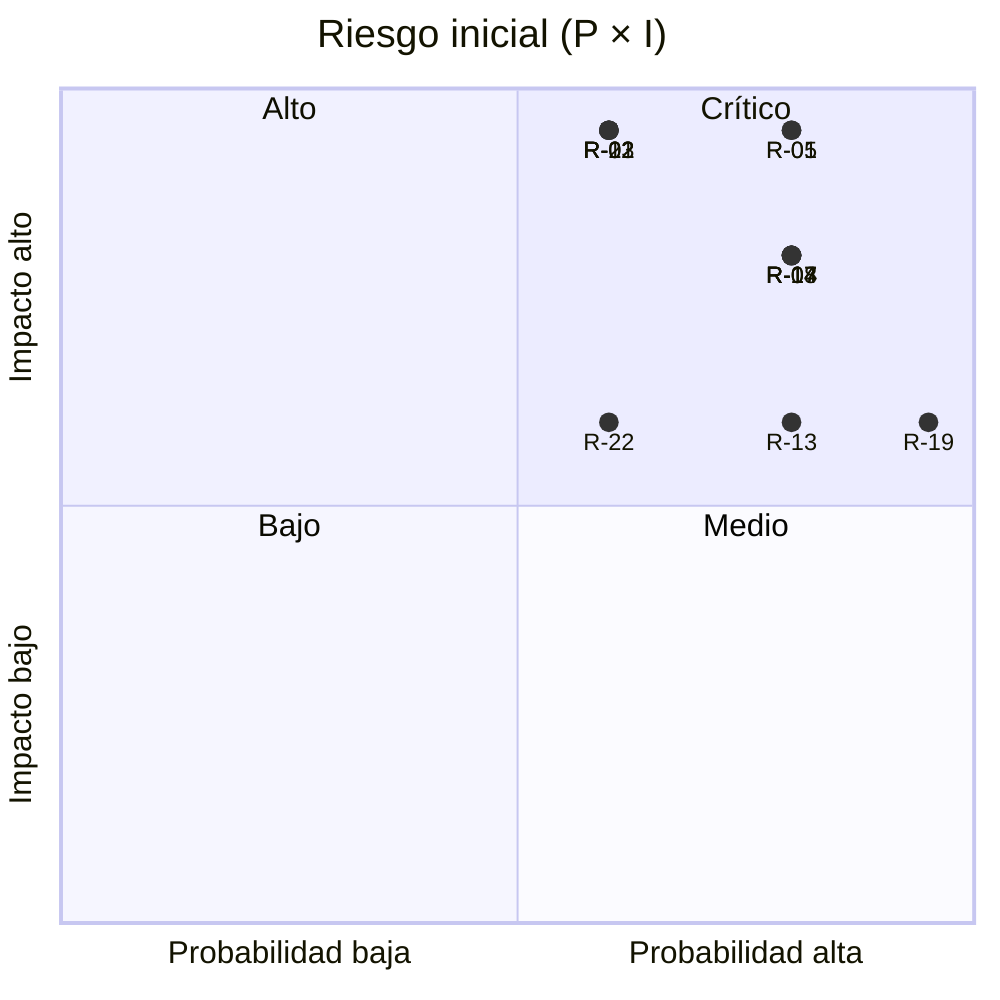
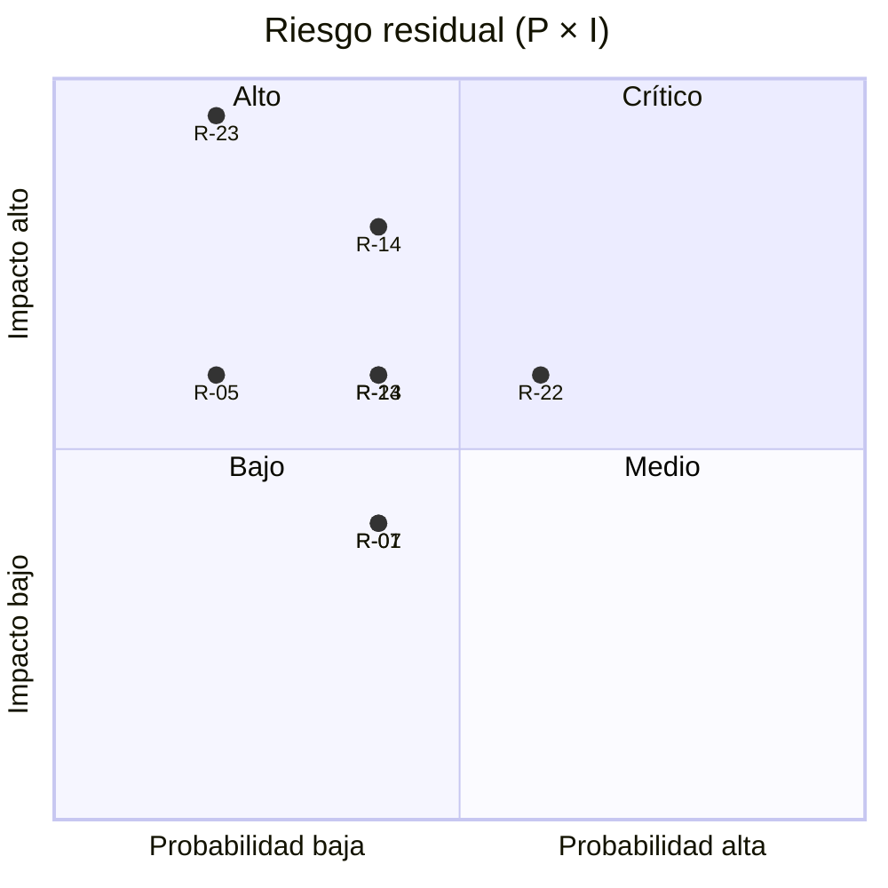

# Matriz de calor (heatmap) antes y después

Dueño: **Arun** con **Javier** · Componente de rúbrica 1 y 4 · Insumo: `docs/01-activos-riesgos/matriz-riesgos.md`

## 1. Escala y zonas

Probabilidad × Impacto (1–5 cada uno).

| P × I | Zona | Color |
|---|---|---|
| 15–25 | Crítico | rojo |
| 10–14 | Alto | naranja |
| 5–9 | Medio | amarillo |
| 1–4 | Bajo | verde |

## 2. Puntos evaluados

| ID | Riesgo | P inicial | I inicial | Score | Zona | P residual | I residual | Score residual | Zona residual |
|---|---|---|---|---|---|---|---|---|---|
| R-01 | IDOR/BOLA cuentas | 4 | 5 | 20 | Crítico | 2 | 2 | 4 | Bajo |
| R-02 | Transferencia no autorizada | 3 | 5 | 15 | Crítico | 1 | 3 | 3 | Bajo |
| R-03 | JWT débil | 3 | 5 | 15 | Crítico | 1 | 3 | 3 | Bajo |
| R-04 | Hash de contraseña débil | 4 | 4 | 16 | Crítico | 2 | 2 | 4 | Bajo |
| R-05 | Secreto expuesto | 4 | 5 | 20 | Crítico | 1 | 3 | 3 | Bajo |
| R-06 | Errores verbosos | 5 | 2 | 10 | Alto | 2 | 2 | 4 | Bajo |
| R-07 | Sin rate limiting | 4 | 4 | 16 | Crítico | 2 | 2 | 4 | Bajo |
| R-08 | Sin WAF | 3 | 4 | 12 | Alto | 1 | 3 | 3 | Bajo |
| R-09 | Origen accesible directo | 3 | 4 | 12 | Alto | 1 | 3 | 3 | Bajo |
| R-10 | Bucket público | 2 | 5 | 10 | Alto | 1 | 3 | 3 | Bajo |
| R-11 | 22/3389 abierto | 2 | 5 | 10 | Alto | 1 | 3 | 3 | Bajo |
| R-12 | BD con IP pública | 3 | 5 | 15 | Crítico | 1 | 3 | 3 | Bajo |
| R-13 | Imagen sin parches | 4 | 3 | 12 | Alto | 2 | 3 | 6 | Medio |
| R-14 | APK sin endurecer | 4 | 4 | 16 | Crítico | 2 | 4 | 8 | Medio |
| R-15 | Datos sin cifrar en móvil | 3 | 4 | 12 | Alto | 1 | 3 | 3 | Bajo |
| R-16 | Admin por canal de clientes | 2 | 5 | 10 | Alto | 1 | 3 | 3 | Bajo |
| R-17 | Pipeline sin controles | 4 | 4 | 16 | Crítico | 2 | 2 | 4 | Bajo |
| R-18 | Sin MFA | 4 | 4 | 16 | Crítico | 1 | 3 | 3 | Bajo |
| R-19 | Sin centralización de logs | 5 | 3 | 15 | Crítico | 2 | 2 | 4 | Bajo |
| R-20 | Sin auditoría de cambios | 4 | 4 | 16 | Crítico | 2 | 2 | 4 | Bajo |
| R-21 | IAM excesivo | 3 | 5 | 15 | Crítico | 1 | 3 | 3 | Bajo |
| R-22 | Un operador de Cloudflare | 3 | 3 | 9 | Medio | 3 | 3 | 9 | Medio |
| R-23 | Dependencia del proveedor | 1 | 5 | 5 | Medio | 1 | 5 | 5 | Medio |
| R-24 | Phishing a admin | 3 | 4 | 12 | Alto | 2 | 3 | 6 | Medio |
| R-25 | Datos reales en capturas | 3 | 4 | 12 | Alto | 1 | 2 | 2 | Bajo |

## 3. Antes

## 4. Después

## 5. Lectura del cambio

| Zona | Inicial | Residual |
|---|---|---|
| Crítico | 13 | 0 |
| Alto | 8 | 0 |
| Medio | 3 | 5 |
| Bajo | 1 | 20 |

Los riesgos que quedan en Medio son los aceptados (R-22, R-23), los que dependen de terceros (R-13 imagen base) y el móvil (R-14), donde el pinning reduce la probabilidad pero no el impacto de un dispositivo comprometido. Se declara explícitamente: **no hay riesgo crítico sin control**.

## 6. Reglas de honestidad

1. El heatmap residual no puede mejorar sin evidencia de la prueba del control.
2. Un riesgo re-puntuado hacia abajo sin cambio técnico es un error, no una mejora.
3. Las cifras finales se recalculan con los datos reales de la fase 4; las de este documento son la proyección del diseño.
