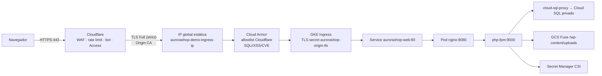
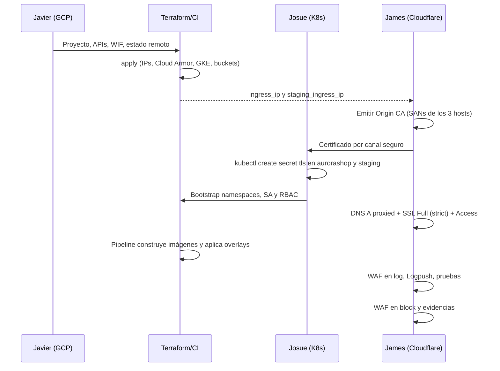

# Integración Cloudflare → GKE

Dueño: **James** (borde y Cloudflare) · Revisa: **Josue** (Ingress, TLS, red) · Depende de: #31, #38, #39

Este documento cierra el hueco entre los manifiestos de `infra/k8s/` y la zona `ancordss.me.uk`: qué registros DNS apuntan al Ingress, cómo se instala el certificado Origin CA, cómo se evita el acceso directo al origen y cómo se verifica cada control.

## 1. Ruta de la petición



Dos planos de control distintos:

| Plano | Lo configura | Lo aplica |
|---|---|---|
| Zona DNS, TLS de borde, WAF, Access, Logpush | James (token API por función) | Dashboard/API de Cloudflare |
| IP estática, Cloud Armor, Ingress, TLS secret, NetworkPolicy | Josue (Terraform + Kustomize) | `terraform apply` y CI con WIF |

Nadie fuera de James toca la zona; nadie fuera de Josue toca el Ingress. El certificado es el único artefacto que cruza ambos planos y se entrega por canal seguro, nunca por Git.

## 2. Registros DNS

Los nombres son subdominios de `ancordss.me.uk`, así que **son registros A proxied, no CNAME**: el contenido de un CNAME debe ser un hostname, nunca una IP.

| Tipo | Nombre | Contenido | Proxy | Origen |
|---|---|---|---|---|
| A | `aurorashop` | `terraform output -raw ingress_ip` | Proxied (naranja) | Ingress demo |
| A | `admin.aurorashop` | misma IP | Proxied | Ingress demo |
| A | `staging.aurorashop` | `terraform output -raw staging_ingress_ip` | Proxied | Ingress staging |

TTL `Auto`. No crear registros `AAAA` hasta que el LB tenga IPv6; un `AAAA` sin destino rompe clientes con IPv6 preferente.

Estado 2026-11-24: la zona tiene 29 registros, ninguno para `aurorashop`, `admin.aurorashop` ni `staging.aurorashop`. No se crean hasta que `terraform apply` devuelva `ingress_ip` y `staging_ingress_ip`; apuntar a una IP provisional solo produce 521/522.

Verificación:

```bash
dig +short aurorashop.ancordss.me.uk        # IPs de Cloudflare, no la del LB
curl -sI https://aurorashop.ancordss.me.uk | grep -i '^server: cloudflare'
```

Si `dig` devuelve la IP del LB, el registro está en gris (DNS only) y el WAF no aplica.

## 3. Certificado Origin CA

Cloudflare termina TLS en el borde y vuelve a cifrar hacia el origen. Con **Full (strict)** el LB debe presentar un certificado que Cloudflare valide: se usa Origin CA, no Let's Encrypt (el origen no es alcanzable desde Internet y el reto HTTP falla).

Un solo certificado cubre los tres hosts y se instala en ambos namespaces:

```bash
openssl req -new -newkey rsa:2048 -nodes \
  -keyout aurorashop-origin.key \
  -out aurorashop-origin.csr \
  -subj "/CN=aurorashop.ancordss.me.uk" \
  -addext "subjectAltName=DNS:aurorashop.ancordss.me.uk,DNS:admin.aurorashop.ancordss.me.uk,DNS:staging.aurorashop.ancordss.me.uk"
```

1. Emitir el certificado en Cloudflare → SSL/TLS → Origin Server → Create Certificate con el CSR y vigencia de 15 años.
2. Guardar `origin.pem` y `origin.key` fuera del repo (gestor de contraseñas del equipo).
3. Crear el Secret en cada namespace con acceso humano al clúster, nunca desde CI:

```bash
gcloud container fleet memberships get-credentials aurorashop-demo \
  --project aurorashop-sec-umg --location global
for ns in aurorashop staging; do
  kubectl create secret tls aurorashop-origin-tls \
    --cert=origin.pem --key=origin.key --namespace "$ns"
done
```

4. Cloudflare → SSL/TLS: modo **Full (strict)**, mínimo TLS 1.2, TLS 1.3 activo, HSTS `max-age=31536000; includeSubDomains` (preload solo al cierre).

El Ingress referencia `secretName: aurorashop-origin-tls`; si el Secret no existe, el balanceador queda sin certificado y Cloudflare responde 526. El orden es: aplicar Terraform → crear Secrets → aplicar overlay.

Estado 2026-11-24: el token actual puede leer Origin CA pero no emitir (`1016 User is not authorized`). La clave y el CSR están generados localmente con SANs de los tres hosts; el certificado se emite en el dashboard o con un token que tenga Origin CA: Edit. No se guardó ninguna clave en Git.

## 4. Origen cerrado

Terraform consulta `https://api.cloudflare.com/client/v4/ips` en cada plan y arma la política `${name_prefix}-${environment}-edge`:

- permitir solo rangos publicados de Cloudflare (grupos de 10 CIDR por regla);
- denegar SQLi, XSS y `cve-canary` (Log4Shell/React RCE) con WAF administrado;
- denegar `*` al final.

El `BackendConfig` de demo y staging apunta a esa política. Un request directo a la IP del LB no viene de Cloudflare y recibe 403 antes de tocar el Ingress.

```bash
IP=$(terraform -chdir=infra output -raw ingress_ip)
curl -skI "https://${IP}/" -H 'Host: aurorashop.ancordss.me.uk'   # esperado 403
curl -sI  https://aurorashop.ancordss.me.uk                       # esperado 200/302
```

Consecuencia de diseño: **Cloud Armor ve la IP del borde de Cloudflare, no la del cliente**. Rate limiting por usuario, geobloqueo y bot management se deciden en Cloudflare; Cloud Armor es la segunda línea y la barrera anti-bypass.

## 5. Cloudflare Access

Solo en `admin.aurorashop` y `staging.aurorashop` (el storefront queda público).

| Aplicación | Política | Sesión | Notas |
|---|---|---|---|
| `admin.aurorashop.ancordss.me.uk` | Allow correos del equipo + `require` 2FA del IdP | 8 h | No usar Bypass en `/wp-login.php` |
| `staging.aurorashop.ancordss.me.uk` | Allow correos del equipo | 8 h | Igual que demo para pruebas |

Pasos: Zero Trust → Access → Applications → Self-hosted → añadir hostname → política Allow por lista de correos → login method One-time PIN o IdP del curso. El DNS debe estar proxied; Access no funciona en gris.

Estado 2026-11-24: no hay aplicaciones de Access y el token no puede leer la organización Zero Trust (`10000 Authentication error`). Se crean en el dashboard o con un token de Access: Apps and Policies: Edit.

El storefront no usa Access: protege login con Turnstile + reglas W-02/W-07 de `waf-cloudflare.md`. `admin.` sí exige Access aunque el atacante conozca credenciales de WordPress: sin identidad de Access no hay respuesta del origen.

## 6. IP real del cliente

Cloud Armor y el LB ven a Cloudflare. Para que WordPress, WooCommerce y los plugins de seguridad registren y limiten por IP real:

1. Cloudflare envía `CF-Connecting-IP` con la IP del cliente y sobrescribe cualquier valor que venga del navegador.
2. El peer inmediato del pod es el GFE, no Cloudflare. Por eso `X-Forwarded-For` termina con la IP del borde.
3. Nginx debe confiar en `CF-Connecting-IP` solo si el peer está en los rangos del balanceador:

```nginx
# Requiere el módulo http_realip_module (nginx oficial lo incluye).
set_real_ip_from 35.191.0.0/16;
set_real_ip_from 130.211.0.0/22;
real_ip_header CF-Connecting-IP;
real_ip_recursive on;
```

4. `fastcgi_params` debe pasar `REMOTE_ADDR` a PHP (`fastcgi_param REMOTE_ADDR $remote_addr;`). Sin eso, WordPress sigue viendo la IP de Cloudflare.

Esto es un requisito para la imagen de Horacio (#40), no un cambio de manifiesto. Verificación: una petición desde una IP conocida debe aparecer en `wp-content/debug.log` o en el panel de un plugin de seguridad con esa IP, no con `172.217.x.x` ni `35.x.x.x`.

## 7. Logpush a GCS

Terraform crea el bucket `${name_prefix}-logs-archive-${project}-${environment}` y ya otorga `roles/storage.objectAdmin` a `logpush@cloudflare-data.iam.gserviceaccount.com`, la cuenta documentada por Cloudflare. No se usan claves JSON.

1. Cloudflare → Logpush → Create job → Google Cloud Storage.
2. Bucket: `aurorashop-logs-archive-aurorashop-sec-umg-demo`; path `cloudflare/http_requests`; subcarpetas diarias activadas.
3. Dataset `HTTP requests`, campos mínimos: `RayID`, `EdgeStartTimestamp`, `ClientIP`, `ClientRequestHost`, `ClientRequestURI`, `ClientRequestMethod`, `EdgeResponseStatus`, `OriginResponseStatus`, `WAFAction`, `WAFRuleID`, `SecurityAction`, `UserAgent`, `Country`.
4. Completar el ownership challenge: Cloudflare escribe un archivo; se abre, se copia el token y se pega en el dashboard.
5. BigQuery: cargar o consultar como tabla externa. El prefijo por fecha permite particionar por `_FILE_NAME` o usar `timestamp` del evento.

Prueba:

```bash
gcloud storage ls --recursive \
  gs://aurorashop-logs-archive-aurorashop-sec-umg-demo/cloudflare/http_requests/ | tail
```

Nota: Cloudflare entrega gzip y GCS hace transcoding; para descargar comprimido usar `Accept-Encoding: gzip`. La alerta crítica del SIEM (#54) se valida contra estos eventos, no contra logs del LB.

Estado 2026-11-24: 0 jobs de Logpush y el bucket `aurorashop-logs-archive-aurorashop-sec-umg-demo` aún no existe. El job se crea después de `terraform apply`; el IAM de `logpush@cloudflare-data.iam.gserviceaccount.com` ya está en Terraform.

## 8. Reglas de borde que dependen del origen

| Regla | Depende de | Verificación |
|---|---|---|
| W-01 XML-RPC | nginx devuelve 403/405 aunque Cloudflare falle | `curl -X POST .../xmlrpc.php` |
| W-05 PHP en uploads | GCS Fuse sin ejecución; nginx no ejecuta `.php` en uploads | subir `.php` y pedirlo |
| W-07 checkout | rate limit de Cloudflare, no de Cloud Armor | 6 POST seguidos |
| W-09 admin solo Access | Access en `admin.` + Cloud Armor cerrado | abrir en ventana privada |
| W-10 scraping | rate limit de Cloudflare | 200 GET a `/shop` |

El detalle de expresiones está en [`waf-cloudflare.md`](waf-cloudflare.md). Toda regla arranca en **log** 24 h y pasa a bloqueo con captura antes/después.

## 9. Orden de ejecución



Sin el paso del certificado, el Ingress queda en 526; sin DNS proxied, Cloud Armor devuelve 403 a todo; sin Access, `admin.` queda solo detrás del login de WordPress.

## 10. Limitaciones declaradas

- **Authenticated Origin Pulls (mTLS)**: el balanceador HTTP(S) de GCP no valida certificados de cliente en el backend, así que no se puede activar mTLS de Cloudflare hacia el origen. Se compensa con la allowlist de Cloud Armor y, opcionalmente, una cabecera secreta inyectada por Transform Rule y validada por Cloud Armor. Se documenta como control no implementado, no como control existente.
- **Cloud Armor no ve la IP real**; las reglas por IP viven en Cloudflare.
- **Origin CA no es una CA pública**: si se desactiva el proxy, los navegadores verán error de certificado. Es intencional: el origen no debe servirse directo.
- **Plan gratuito**: bot management avanzado y algunas reglas administradas requieren plan pago; lo que no esté disponible se compensa en Cloud Armor o en la aplicación y se registra en la tabla de limitaciones del informe.
- **Logpush** puede duplicar archivos y tarda minutos; el SIEM debe ser idempotente por `RayID`.

## 11. Checklist de cierre (#31)

- [x] Tres registros A proxied creados y `dig` devuelve IPs de Cloudflare (34.8.197.115 demo, 136.68.90.143 staging).
- [ ] Certificado Origin CA con SANs de los tres hosts instalado en `aurorashop` y `staging`.
- [ ] SSL/TLS Full (strict), TLS 1.2 mínimo, HSTS configurado.
- [ ] `curl` directo a la IP del LB devuelve 403; por Cloudflare devuelve 200/302.
- [ ] Access activo en `admin.` y `staging.`; sin sesión devuelve login de Access.
- [ ] WAF custom en log con capturas; checkout intacto.
- [ ] Logpush escribiendo en GCS y eventos consultables.
- [ ] Evidencias en `evidencias/fase5/waf-<fecha>/` con comando y fecha.

## 12. Estado de aplicación al 2026-11-24

| Control | Estado | Bloqueo |
|---|---|---|
| Infra Terraform | **Aplicada**: GKE, Cloud SQL, buckets, KMS, AR, secretos, Cloud Armor | — |
| DNS de los 3 hosts | **3/3 proxied** | Origen aún sin Ingress |
| Origin CA | Clave y CSR listos; certificado no emitido | Token sin Origin CA: Edit |
| WAF custom | 5 reglas staged, `enabled=false` | Falta origen para smoke test |
| Managed Free Ruleset | Staged, `enabled=false` | Falta origen para smoke test |
| Access | 0 aplicaciones | Token sin organización Zero Trust |
| Logpush | 0 jobs | Bucket listo; falta crear el job |
| SSL/TLS/HSTS | Sin verificar | Token sin Zone Settings: Read/Edit |

IPs: demo/admin `34.8.197.115`; staging `136.68.90.143`. Cloud SQL privado `10.40.0.3`. El resto de hosts de la zona no se tocó.

La zona es **Free**: 5 reglas custom, sin acción `log` ni regex, y Managed Free Ruleset en lugar de OWASP CRS completo. Estas limitaciones se declaran en el informe; lo que no cubre el plan se compensa en Cloud Armor (#38) y en la aplicación.
