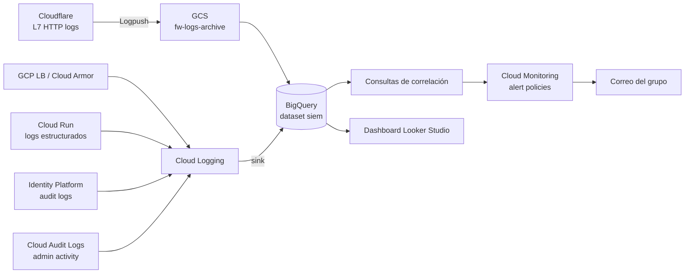

# SIEM y correlación de eventos

Dueño: **Arun** · Componente de rúbrica 4 · Alcance: gratuito (Cloud Logging + BigQuery + Cloud Monitoring)

## 1. Arquitectura de recolección

## 2. Fuentes y retención

| Fuente | Destino | Retención | Qué aporta |
|---|---|---|---|
| Cloudflare Logpush (HTTP requests) | GCS → BigQuery | 90 días | IP, país, regla WAF, acción |
| Cloud Run stdout (JSON) | Cloud Logging → sink | 30 días + 90 en BQ | `sub`, ruta, status, latencia |
| Identity Platform | Cloud Logging | 30 días | logins, MFA, fallos |
| Cloud Audit Logs (admin activity) | sink a BQ | 90 días | cambios de IAM, recursos |
| Cloud Armor | Cloud Logging | 30 días | bloqueos de segunda capa |
| GitHub Actions audit | exportación manual | repo | cambios de workflow |

## 3. Consultas de correlación (ejecutables en BigQuery)

1. **Fuerza bruta:** `SELECT ip, COUNT(*) FROM siem.cf_http WHERE uri LIKE '/v1/auth/%' AND status IN (401,403) GROUP BY ip HAVING COUNT(*) > 20 ORDER BY 2 DESC`.
2. **IDOR:** agrupar 403 por `sub` y `account_id_hash` en 10 minutos.
3. **Paginación abusiva:** contar peticiones a `movements` por `sub` con `offset > 1000`.
4. **Bypass de WAF:** peticiones que llegan al origen con payload sospechoso (comparar `cf.waf.action` = allow y `uri` con patrones SQLi).
5. **Cambio de IAM:** `protoPayload.methodName = "SetIamPolicy"` fuera de la ventana de despliegue.
6. **Token sin MFA:** eventos con `amr` sin `mfa` en rutas de transferencia.
7. **Volumen de egreso:** transferencias por `sub` por hora vs. promedio del mismo usuario.

Cada consulta se guarda en `evidencias/fase5/siem/` con su resultado y fecha.

## 4. Alertas

| ID | Nombre | Condición | Severidad | Destino |
|---|---|---|---|---|
| AL-01 | Fuerza bruta sostenida | > 20 fallos/min por IP | alta | correo |
| AL-02 | Acceso a objeto ajeno | > 5 × 403 por `sub` en 10 min | crítica | correo + issue |
| AL-03 | Token sin MFA en transferencia | ≥ 1 evento | crítica | correo |
| AL-04 | Cambio de IAM | cualquier `SetIamPolicy` | alta | correo |
| AL-05 | Pico de 5xx | > 5% en 5 min | media | correo |
| AL-06 | Exportación masiva | > 2/hora por usuario | alta | correo |
| AL-07 | Origen accedido sin Cloudflare | petición al `*.run.app` con 200 | crítica | correo |

## 5. Dashboard mínimo

- Peticiones totales vs. bloqueadas por WAF (por regla).
- Top IP/país/ASN por bloqueos.
- Logins exitosos vs. fallidos; MFA challenge rate.
- 4xx/5xx por endpoint.
- Transferencias por hora y monto total.
- Eventos de auditoría IAM y despliegues.

## 6. Prueba de detección (obligatoria)

Para cada alerta crítica se ejecuta una prueba controlada dentro de la ventana de pentest y se registra: hora del evento, hora de la alerta, diferencia y captura. La latencia objetivo es < 2 minutos. Una alerta que nunca se probó se reporta como "no verificada".

## 7. Limitaciones

- Sin retención de largo plazo ni correlación multi-fuente avanzada (no hay licencia de Chronicle/Splunk): se declara como arquitectura de referencia y se muestra el equivalente gratuito.
- El envío de correo puede tener retraso; para el curso se acepta y se documenta.
