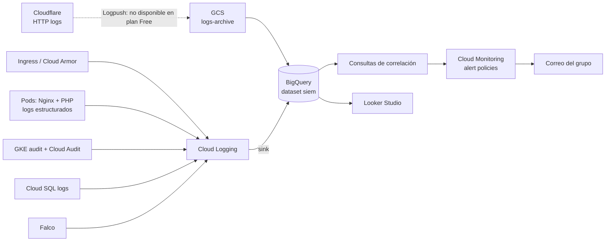

# SIEM y correlación de eventos

Dueño: **Arun** · Componente de rúbrica 4 · Stack gratuito: Cloud Logging + BigQuery + Cloud Monitoring

## 1. Arquitectura de recolección

## 2. Fuentes y retención

| Fuente | Destino | Retención | Aporta |
|---|---|---|---|
| Cloudflare Logpush | GCS → BigQuery | 90 días | IP, país, regla WAF, acción, bot score. **No disponible**: el plan Free devuelve `1004 logpush is not enabled` (`evidencias/fase5/waf-2026-11-24/estado-cloudflare.md`). Se compensa con los logs del balanceador y de Cloud Armor, más Cloudflare Analytics en el dashboard |
| Balanceador + Cloud Armor | Cloud Logging | 30 días | peticiones rechazadas al origen (AL-07). **Hoy apagado**: falta `logging.enable` en la `BackendConfig` |
| Nginx/PHP (pods) | Cloud Logging → sink | 30 días + 90 en BQ | ruta, usuario, status, latencia, `request_id` |
| WooCommerce (auditoría) | Cloud Logging | 30 días | pedidos, cupones, exportaciones, autor |
| Cloud Audit Logs (admin) | sink a BQ | 90 días | IAM, `exec`, cambios de recursos |
| GKE audit | Cloud Logging | 30 días | RBAC, API, admissions |
| Cloud SQL | Cloud Logging | 30 días | errores, conexiones, auditoría |
| Falco | Cloud Logging | 30 días | procesos, escrituras, anomalías |
| GitHub Actions | artifact | repo | cambios de workflow y despliegues |

## 3. Consultas de correlación

SQL de BigQuery en `infra/siem/queries/` (#41), sobre las tablas que exporta el sink `aurorashop-demo-security-to-bigquery` al dataset `aurorashop_demo_security_logs`. Tablas, columnas y forma de ejecución: `infra/siem/README.md`.

| ID | Consulta | Fuente real | Ajuste frente al diseño |
|---|---|---|---|
| Q-01 | **Fuerza bruta:** fallos por IP en `/wp-login.php` en 5 min > 20 | `stdout` (Nginx) | Fallo = `POST` con 200; éxito = 302 |
| Q-02 | **Exploit de plugin:** 403/404 concentrados en rutas de un plugin | `stdout` (Nginx) | Sin el payload: Nginx registra `$uri`, sin query string |
| Q-03 | **IDOR:** rechazos a rutas de pedidos en 10 min | `stdout` (Nginx) | Por IP, porque el log no trae usuario. La variante por usuario necesita el evento `order_access_denied` (#55) |
| Q-04 | **Card testing:** checkouts fallidos por IP > 10/hora | `stdout` (Nginx) | Sin monto. La variante `< 5` necesita el evento `checkout_failed` (#55) |
| Q-05 | **Bypass de WAF:** firma de ataque en la ruta y respuesta < 400 | `stdout` (Nginx) | Sin `cf.waf.action`, porque no hay Logpush |
| Q-06 | **Cambio de IAM/RBAC** fuera del CI | `cloudaudit_googleapis_com_activity` | Se excluye `sa-gh-deployer` en vez de una ventana horaria |
| Q-07 | **Integridad:** hash del CMS distinto del baseline | `stderr` (`aurora_event`) | Depende del chequeo de #55 |
| Q-08 | **Egreso anómalo** desde el pod | Falco | Depende de Falco y de añadir el namespace `falco` al sink |
| Q-09 | `kubectl exec`/`attach` en `aurorashop` | `cloudaudit_googleapis_com_activity` | Nueva: cubre RT-01/RT-10 aunque Falco no se admita en Autopilot |
| Q-10 | Petición servida con un `Host` ajeno | `stdout` (Nginx) | Nueva: soporte de AL-07 |
| Q-11 | Tasa de 5xx | `stdout` (Nginx) | Nueva: soporte de AL-08 |

Las consultas pasan el parser del dialecto BigQuery (`sqlglot`), pero **no se han ejecutado** porque Arun no tiene `roles/bigquery.jobUser`. Al ejecutarlas por primera vez (#54) hay que confirmar los nombres de tablas y columnas con `bq show --schema`. Cada resultado se guarda en `evidencias/fase5/siem/` con fecha.

## 4. Alertas

Las alertas son de Cloud Monitoring sobre Cloud Logging, no sobre BigQuery, para no sumar la latencia del sink. Los filtros y las plantillas JSON de AL-02, AL-04 y AL-07 están en `infra/siem/alerts/`.

| ID | Nombre | Condición | Severidad | Destino |
|---|---|---|---|---|
| AL-01 | Fuerza bruta | > 20 fallos/min por IP | alta | correo |
| AL-02 | Acceso a pedido ajeno | > 5 × 403 por usuario en 10 min | crítica | correo + issue |
| AL-03 | Card testing | > 10 pedidos fallidos/hora por IP | alta | correo |
| AL-04 | Shell en pod | evento Falco RT-01 | crítica | correo + on-call |
| AL-05 | Cambio de archivos del CMS | RT-03/RT-04 | crítica | correo |
| AL-06 | Cambio de IAM/RBAC | cualquier `SetIamPolicy` o rolebinding | alta | correo |
| AL-07 | Origen accedido sin Cloudflare | petición al LB sin Host válido con 200 | crítica | correo |
| AL-08 | Error 5xx | > 5% en 5 min | media | correo |

## 5. Dashboard mínimo

- Peticiones vs. bloqueos WAF por regla; top IP/país/ASN.
- Logins exitosos/fallidos y challenges MFA.
- Pedidos por hora, tasa de fallo y monto total.
- 403 por endpoint REST; 404 por ruta de plugin.
- Eventos de auditoría (IAM, `exec`, despliegues).
- Estado de pods, reinicios y HPA.

## 6. Prueba de detección (obligatoria)

Cada alerta crítica se dispara en prueba controlada dentro de la ventana y se registra: hora del evento, hora de la alerta, diferencia y captura. Objetivo < 2 minutos. Una alerta no probada se reporta como "no verificada".

## 7. Limitaciones

- Sin retención de largo plazo ni correlación multi-fuente avanzada (sin Chronicle/Splunk): se muestra el equivalente gratuito y se declara como arquitectura de referencia.
- El correo puede tener retraso; se acepta para el curso y se documenta.
