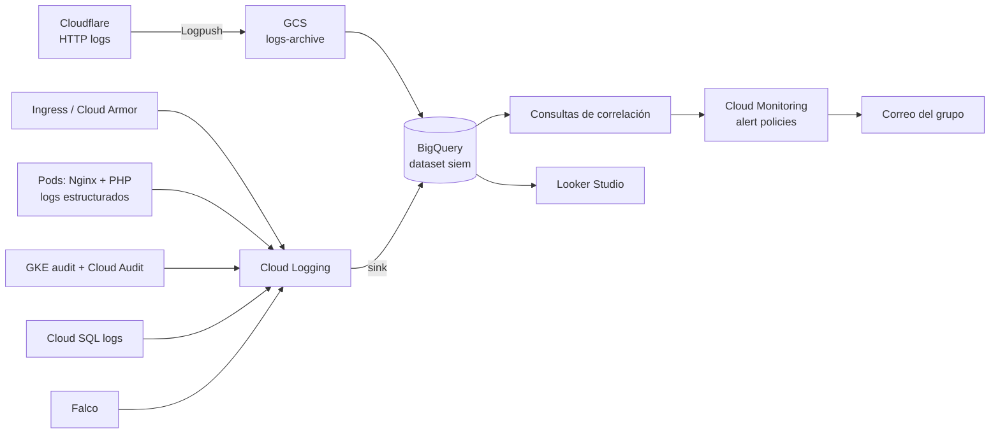

# SIEM y correlación de eventos

Dueño: **Arun** · Componente de rúbrica 4 · Stack gratuito: Cloud Logging + BigQuery + Cloud Monitoring

## 1. Arquitectura de recolección

## 2. Fuentes y retención

| Fuente | Destino | Retención | Aporta |
|---|---|---|---|
| Cloudflare Logpush | GCS → BigQuery | 90 días | IP, país, regla WAF, acción, bot score |
| Nginx/PHP (pods) | Cloud Logging → sink | 30 días + 90 en BQ | ruta, usuario, status, latencia, `request_id` |
| WooCommerce (auditoría) | Cloud Logging | 30 días | pedidos, cupones, exportaciones, autor |
| Cloud Audit Logs (admin) | sink a BQ | 90 días | IAM, `exec`, cambios de recursos |
| GKE audit | Cloud Logging | 30 días | RBAC, API, admissions |
| Cloud SQL | Cloud Logging | 30 días | errores, conexiones, auditoría |
| Falco | Cloud Logging | 30 días | procesos, escrituras, anomalías |
| GitHub Actions | artifact | repo | cambios de workflow y despliegues |

## 3. Consultas de correlación

1. **Fuerza bruta:** fallos por IP en `/wp-login.php` en 5 min > 20.
2. **Exploit de plugin:** 404/403 concentrados en rutas de un plugin específico + payload en query.
3. **IDOR:** 403 por `user_id` con `order_id` distinto en 10 min.
4. **Card testing:** pedidos fallidos por IP > 10/hora con montos < 5.
5. **Bypass de WAF:** peticiones al pod con `cf.waf.action = allow` y payload sospechoso.
6. **Cambio de IAM/RBAC:** `SetIamPolicy` o `create rolebinding` fuera de ventana de despliegue.
7. **Integridad:** hash de archivos del CMS ≠ baseline desplegado.
8. **Egreso anómalo:** peticiones del pod a dominios no permitidos.

Cada consulta se guarda en `evidencias/fase5/siem/` con resultado y fecha.

## 4. Alertas

| ID | Nombre | Condición | Severidad | Destino |
|---|---|---|---|---|
| AL-01 | Fuerza bruta | > 20 fallos/min por IP | alta | correo |
| AL-02 | Acceso a pedido ajeno | > 5 × 403 por usuario en 10 min | crítica | correo + issue |
| AL-03 | Card testing | > 10 pedidos fallidos/hora por IP | alta | correo |
| AL-04 | Shell en pod | evento Falco RT-01 | crítica | correo + on-call |
| AL-05 | Cambio de archivos del CMS | RT-03/RT-04 | crítica | correo |
| AL-06 | Cambio de IAM/RBAC | cualquier `SetIamPolicy` o rolebinding | alta | correo |
| AL-07 | Origen accedido sin Cloudflare | petición al LB sin Host válido con 200 | crítica | correo |
| AL-08 | Error 5xx | > 5% en 5 min | media | correo |

## 5. Dashboard mínimo

- Peticiones vs. bloqueos WAF por regla; top IP/país/ASN.
- Logins exitosos/fallidos y challenges MFA.
- Pedidos por hora, tasa de fallo y monto total.
- 403 por endpoint REST; 404 por ruta de plugin.
- Eventos de auditoría (IAM, `exec`, despliegues).
- Estado de pods, reinicios y HPA.

## 6. Prueba de detección (obligatoria)

Cada alerta crítica se dispara en prueba controlada dentro de la ventana y se registra: hora del evento, hora de la alerta, diferencia y captura. Objetivo < 2 minutos. Una alerta no probada se reporta como "no verificada".

## 7. Limitaciones

- Sin retención de largo plazo ni correlación multi-fuente avanzada (sin Chronicle/Splunk): se muestra el equivalente gratuito y se declara como arquitectura de referencia.
- El correo puede tener retraso; se acepta para el curso y se documenta.
