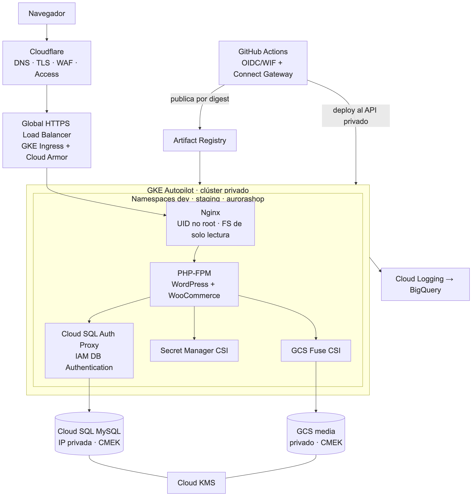
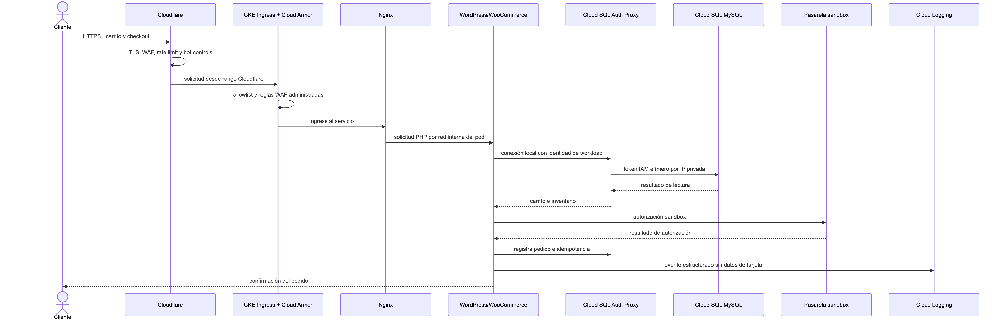
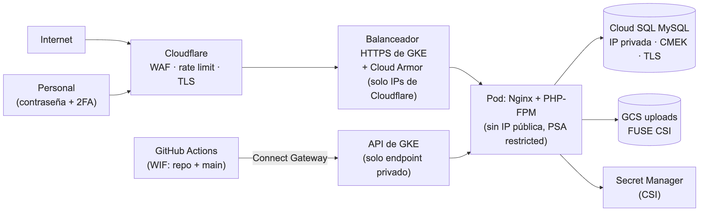
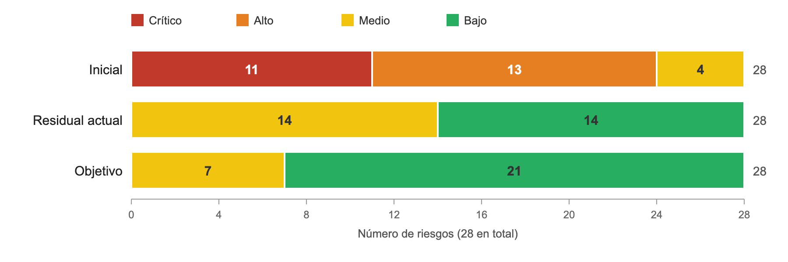

# Informe final — Opción B (CMS / E-Commerce Web Enterprise Cloud-Native)

Universidad Mariano Gálvez de Guatemala · Facultad de Ingeniería en Sistemas de Información · Programa de Posgrados · Maestría en Seguridad Informática · Curso: Seguridad en Aplicaciones (093-013) · Docente: Mario Estuardo Chajón Arriaza

**Título:** Evaluación, rediseño e implementación de seguridad continua en AuroraShop, e-commerce WordPress/WooCommerce cloud-native sobre Google Cloud

**Integrantes:** Hector James Maradiaga López · Javier Oliva · Josue · Horacio · Arun

Guatemala, diciembre de 2026

---

## Resumen ejecutivo

AuroraShop es una tienda WordPress 7.1.5 + WooCommerce 11.3.1 en GKE Autopilot, con Cloud SQL MySQL 8 privado, medios en Cloud Storage y entrega por Cloudflare. El proyecto evaluó ese sistema con datos sintéticos, lo rediseñó por capas y desplegó los controles verificables con el presupuesto disponible.

El método siguió el ciclo ISO/IEC 27001:2022: inventario de 26 activos —15 críticos—, STRIDE, DREAD y una matriz de 28 riesgos (Javier Oliva); arquitectura Zero Trust con segmentación, CMEK y Workload Identity (Josue); pentest de caja negra y caja gris con verificación OWASP independiente (Horacio y Arun); y un pipeline con gitleaks, Semgrep, WPScan, Composer audit, Trivy, Checkov/tfsec y Kubesec.

Tres hallazgos principales. Primero, el perímetro resistió: el origen responde 403 fuera de Cloudflare, XML-RPC da 403, el login devuelve 429 desde el tercer intento, 28 rutas sensibles dan 403/404 y no hubo IDOR, XSS almacenado, SQLi ni manipulación de precio en las pruebas ejecutadas. Segundo, la autorización de WooCommerce es sólida cuando se configura bien: cinco casos de abuso quedaron bloqueados y la única fuga real (H-09, descarga sin sesión) se corrigió con regresión. Tercero, las brechas restantes son de configuración y proceso: TLS 1.0/1.1 sin HSTS, `admin-` sin Cloudflare Access, `staging` con DNS huérfano (502), red `default` con SSH/RDP abiertos, `main` sin branch protection, el gate de WPScan fallando abierto (S-04), CORS permisivo (H-11) y catálogo sin límite de tasa (H-12).

Controles implementados y verificados: WAF en bloqueo con cinco reglas y rate limit, Cloud Armor con allowlist, Pod Security `restricted`, NetworkPolicy default-deny, secretos por CSI, CMEK, 2FA obligatorio y logs centralizados; el 27 de noviembre se confirmó que Cloud Logging recibe peticiones del balanceador y denegaciones de Cloud Armor.

Riesgo residual: cero críticos y cero altos; 14 medios y 14 bajos. De 12 hallazgos, ocho cerrados o no reproducidos, tres abiertos y uno aceptado. Dictamen: apto como demo académica con evidencia reproducible; no apto para producción con pagos reales hasta cerrar los controles pendientes del roadmap de 30 días.

**Palabras clave:** seguridad de aplicaciones, WordPress, WooCommerce, GKE, Zero Trust, WAF, DevSecOps, ISO 27001.

---

## Índice general

Índice generado a partir de los títulos del documento y de las páginas del PDF de `docs/06-informe/salida/`; si se edita el contenido, se regenera con el mismo procedimiento.

---

## 1. Selección y planificación

### 1.1 Contexto del CMS / E-Commerce

*Autor: Horacio · Fuentes: `README.md`, `docs/00-plan/alcance.md` §2*

AuroraShop se evaluó como CMS/e-commerce empresarial, no como un sitio institucional. Esa decisión de alcance define qué se prueba: la superficie de plugins, el checkout, la API REST de WooCommerce, el rol del borde y la cadena de suministro del CMS. La tienda usa datos sintéticos —60 productos, 40 clientes, 150 pedidos y 30 cupones— y una pasarela en modo sandbox, de modo que ningún hallazgo expone datos de personas reales (`docs/00-plan/alcance.md` §6).

El perfil técnico resumido se presenta en la Tabla 1. La elección de WordPress + WooCommerce fue deliberada: concentra los riesgos que la cátedra exige demostrar (A01 control de acceso, A03 inyección, A04 diseño inseguro, A06 componentes vulnerables) y obliga a resolverlos en tres planos distintos: aplicación, contenedor y borde.

**Tabla 1.** Perfil de seguridad de AuroraShop

| Elemento | Decisión | Implicación de seguridad |
|---|---|---|
| CMS / E-commerce | WordPress 7.1.5 + WooCommerce 11.3.1 sobre PHP 8.3 | Superficie de plugins y REST pública |
| Cómputo | GKE Autopilot, namespace `aurorashop`, 2–6 pods, HPA | PSA `restricted`, RBAC namespaced, red deny-all |
| Base de datos | Cloud SQL MySQL 8, IP privada, CMEK | Sin acceso desde Internet; proxy con IAM |
| Media | Bucket GCS privado + CDN | Sin ejecución de PHP en `uploads` |
| Borde | Cloudflare (DNS, WAF, rate limit, Access, Logpush) | Primer filtro y punto de control de bots |
| Nube | GCP: GKE, Cloud SQL, KMS, Secret Manager, Artifact Registry, Cloud Logging, Cloud Armor | Cifrado, identidad y auditoría administradas |
| CI/CD | GitHub Actions con OIDC/WIF | Sin claves JSON; deploy por digest |
| Hosts | `aurorashop`, `admin-aurorashop`, `staging-aurorashop` bajo `ancordss.me.uk` | Tres entradas, tres políticas de acceso |

*Nota.* Elaborada a partir de `README.md` y `docs/00-plan/alcance.md` §3–5. Los tres hosts apuntan a dos IP globales distintas: demo/admin a `34.8.197.115` y staging a `136.68.90.143` (`docs/05-operaciones/integracion-cloudflare-gke.md` §2).

### 1.2 Objetivos del proyecto

*Autor: James · Fuente: `docs/00-plan/alcance.md` §1*

Objetivo general: evaluar, rediseñar e implementar seguridad continua sobre AuroraShop, con evidencia reproducible y un dictamen técnico verificable.

Objetivos específicos:

1. Inventariar y clasificar los activos del sistema conforme a ISO/IEC 27001:2022, con criticidad calculada y propietario identificado.
2. Modelar amenazas con STRIDE y priorizarlas con DREAD y CVSS 4.0 (FIRST, 2023), produciendo una matriz de riesgos tratable.
3. Evaluar la aplicación con pentest de caja negra y caja gris, cubriendo las diez categorías de OWASP Top 10:2021 (OWASP Foundation, 2021a).
4. Rediseñar la arquitectura con principios Zero Trust (NIST, 2020) y segmentación de red, cifrado y menor privilegio verificables.
5. Integrar controles DevSecOps en el pipeline: secretos, SAST, SCA, IaC, contenedores y prueba de humo.
6. Operar el sistema con WAF, detección en ejecución, SIEM y alertas, midiendo el riesgo residual.
7. Documentar el ciclo completo en formato UMG/APA 7, distinguiendo lo verificado de lo declarado.

El criterio de éxito no fue "tener controles escritos" sino "tener controles probados". Por eso el informe separa explícitamente los controles declarados en YAML de los verificados en ejecución, y ninguna tabla marca como cerrado un control sin evidencia asociada.

### 1.3 Alcance

*Autor: James · Fuente: `docs/00-plan/alcance.md` §§3–5*

La Tabla 2 delimita el alcance acordado; todo lo que no figura en la columna izquierda se declara como exclusión y no se usa como evidencia.

**Tabla 2.** Dentro y fuera del alcance

| Dentro del alcance | Fuera del alcance |
|---|---|
| CMS, plugins, tema hijo y código propio | Tienda en producción con clientes o pagos reales |
| Imagen multi-stage, GKE, NetworkPolicy, PSA, RBAC | Migración de CMS, ERP y multiidioma avanzado |
| Cloud SQL privado, CMEK, Secret Manager | Pruebas de denegación de servicio y volumétricas |
| Cloudflare WAF, rate limit, Access, Logpush | Certificación formal PCI-DSS, SOC 2 o ISO 27001 |
| Pentest caja negra y caja gris sobre hosts propios | Pentest de terceros o de otros subdominios de la zona |
| SAST/SCA/IaC/contenedores y pipeline | Apps móviles y API pública de terceros |
| SIEM gratuito (Cloud Logging + BigQuery), Falco | Chronicle, Splunk o UEBA histórico |
| Ambientes `dev`, `demo`, `staging`, `break-glass` | Producción multi-región con DR contractual |

*Nota.* Elaborada a partir de `docs/00-plan/alcance.md` §§3–5.

Los ambientes tienen propósitos distintos y eso condiciona la evidencia: `demo` es público y se usa para pentest; `staging` debía ser la réplica para pruebas destructivas, pero al 27 de noviembre responde 502 por un registro DNS huérfano (P-10). `dev` existe en el clúster pero sus pods llevan dos días en `Init:0/1`; no se usó como fuente de evidencia. El ambiente `break-glass` es un procedimiento operado solo por James, no un despliegue permanente.

Una restricción material del alcance es el plan Cloudflare Free: cinco reglas custom, sin acción `log`, sin regex y una sola regla de rate limiting con mitigación máxima de 10 segundos. Todo control que exceda esa cuota se declara como limitación y se compensa en Cloud Armor, Nginx o la aplicación (`docs/05-operaciones/waf-cloudflare.md` §2).

### 1.4 Normativas y estándares de referencia

*Autor: Javier · Fuente: `docs/00-plan/alcance.md` §7*

El proyecto se apoya en ISO/IEC 27001:2022 para el sistema de gestión y ISO/IEC 27005:2022 para el proceso de riesgo (International Organization for Standardization [ISO/IEC], 2022a, 2022b). La evaluación técnica usa OWASP Top 10:2021, OWASP ASVS 5.0 como meta de verificación (OWASP Foundation, 2025), el Web Security Testing Guide (OWASP Foundation, 2021b) y las Cheat Sheets para las remediaciones concretas (OWASP Foundation, 2024).

En infraestructura se aplican el CIS Kubernetes Benchmark (Center for Internet Security, 2024), la guía de hardening de contenedores de NIST SP 800-190 (National Institute of Standards and Technology [NIST], 2017) y Zero Trust de NIST SP 800-207 (NIST, 2020). El desarrollo seguro se alinea con el SSDF (NIST, 2022) y con el hardening de GitHub Actions (GitHub, 2024). PCI-DSS v4.0 se usa como referencia de protección de datos de pago sin pretender certificación (PCI Security Standards Council [PCI SSC], 2022); en el plano local, el Reglamento para la gestión de riesgo tecnológico de la Junta Monetaria de Guatemala aporta el criterio de riesgo tecnológico aplicable al contexto guatemalteco (Junta Monetaria de Guatemala, 2011).

### 1.5 Definición del scope técnico

*Autor: Josue · Fuente: `docs/02-arquitectura/arquitectura-seguridad.md` §§1–3*

El scope técnico se fijó en cinco principios verificables: Zero Trust, borde primero, inmutabilidad del contenedor, cifrado por defecto y menor privilegio comprobable, alineados con la guía de fundamentos de seguridad de Google Cloud (Google Cloud, 2024c). La arquitectura resultante tiene tres planos de control separados —zona Cloudflare, proyecto GCP y clúster— y una regla dura: ningún tráfico llega a un pod sin pasar por el balanceador y su política de Cloud Armor.

La Figura 1 resume el flujo; su fuente editable es `docs/02-arquitectura/diagramas/c4-contenedores.mmd`.

**Figura 1.** Arquitectura de contenedores de AuroraShop

{width=15.5cm}

*Nota.* Exportada desde `docs/02-arquitectura/diagramas/c4-contenedores.mmd`; el diagrama de contexto C4 está en `c4-contexto.mmd`.

El flujo de checkout agrega dos controles que no son evidentes en el diagrama de contenedores: recálculo de precios en servidor y autorización por objeto del pedido. La Figura 2 documenta ese recorrido.

**Figura 2.** Flujo de checkout con controles

{width=15.5cm}

*Nota.* Exportada desde `docs/02-arquitectura/diagramas/flujo-checkout.mmd`.

---

## 2. Activos y riesgos

### 2.1 Inventario de activos (ISO 27001)

*Autor: Javier · Fuente: `docs/01-activos-riesgos/inventario-activos.md`*

El inventario registra 26 activos con proceso, tipo, ubicación, valoración CIA, criticidad calculada, justificación, propietario, custodio y usuarios con acceso. La Tabla 3 resume la distribución; el detalle completo está en la tabla del documento fuente.

**Tabla 3.** Inventario de activos (resumen por criticidad)

| Criticidad | Activos | Ejemplos |
|---|---|---|
| Crítica (15) | A-01 a A-05, A-12 a A-17, A-19 a A-22 | Datos de clientes, pedidos, credenciales admin, pipeline, CMEK, MySQL, panel admin |
| Alta (9) | A-06 a A-11, A-18, A-23, A-25 | Plugins, tema, imagen, media, manifiestos, Terraform, logs, repo, laptops |
| Media (2) | A-24, A-26 | Documentación de seguridad, cuentas demo |

*Nota.* Elaborada a partir de `docs/01-activos-riesgos/inventario-activos.md` e `clasificacion-cia.md` §3.

Dos decisiones de método importan para leer el resto del informe. Primera: el inventario es de diseño en la semana 1 y se contrasta contra el clúster real en la semana 2; toda diferencia se registra como hallazgo y no se corrige en silencio. Segunda: los activos críticos justifican el diseño. Si un control no protege al menos un activo crítico, debe justificarse por qué está en el alcance.

### 2.2 Clasificación CIA y criticidad

*Autor: Javier · Fuente: `docs/01-activos-riesgos/clasificacion-cia.md`*

La clasificación usa A/M/B por dimensión, calcula `max(C,I,A)` y suma un punto cuando el activo está expuesto a Internet o no tiene repuesto, con tope en 3. El resultado son 14 activos críticos, 10 altos y 2 medios. El ajuste por exposición explica por qué DNS/TLS (A-16) y la configuración de Cloudflare (A-17) son críticos aunque su valoración individual sea mixta: un error ahí afecta a todos los hosts a la vez.

### 2.3 Modelado de amenazas (STRIDE)

*Autor: Javier · Fuente: `docs/01-activos-riesgos/stride.md`*

El modelado descompone el sistema en 14 componentes y flujos y aplica las seis categorías STRIDE (Shostack, 2014). Se identificaron 56 amenazas con ID estable `T-NN`, cada una ligada a un componente, un actor y —cuando se probó— un hallazgo `H-NN`.

La Tabla 4 resume las ocho amenazas priorizadas por componente y actor.

**Tabla 4.** Amenazas STRIDE priorizadas

| ID | Amenaza | Componente | Actor | Riesgo |
|---|---|---|---|---|
| T-18 | IDOR en pedidos por REST | WooCommerce REST | Cliente autenticado | R-05 |
| T-16 | RCE por plugin desactualizado | Plugins | Externo | R-01 |
| T-11 | Carga y ejecución de PHP en uploads | Media | Insider | R-08 |
| T-09 | CSRF sin nonce en administración | Admin | Externo | R-04 |
| T-47 | PR malicioso que exfiltra secretos | CI/CD | Colaborador | R-23 |
| T-50 | Cuenta de servicio con `editor` | IAM | Atacante en runner | R-23 |
| T-01 | Fuerza bruta en `wp-login` | Login | Externo | R-06 |
| T-22 | Card testing en checkout | Checkout | Externo | R-16 |

*Nota.* Elaborada a partir de `docs/01-activos-riesgos/stride.md` §§2–3.

### 2.4 Clasificación de riesgos (DREAD)

*Autor: Javier · Fuente: `docs/01-activos-riesgos/dread.md`*

DREAD se usó como priorización de negocio, no como sustituto de CVSS. Se puntuaron 24 amenazas con la fórmula `(D+R+E+A+D)/5`; cuando existe CVE o PoC se registra CVSS 4.0 y se conserva DREAD para ordenar el trabajo.

La Tabla 5 presenta el extracto de mayor puntuación.

**Tabla 5.** Scoring DREAD (extracto)

| ID | Amenaza | DREAD | Severidad |
|---|---|---:|---|
| T-18 | IDOR en pedidos | 9.0 | Crítica |
| T-01 | Fuerza bruta en login | 8.8 | Crítica |
| T-05 | Amplificación XML-RPC | 8.4 | Crítica |
| T-35 | `wp-config` expuesto | 8.4 | Crítica |
| T-16 / T-12 / T-37 / T-54 | RCE por plugin, SQLi, bucket público, datos reales en capturas | 8.2 | Crítica |
| T-46 | DDoS volumétrico | 7.8 | Alta |
| T-11 / T-22 / T-44 / T-23 | Upload PHP, card testing, bypass de origen, scraping | 7.6 | Alta |

*Nota.* Elaborada a partir de `docs/01-activos-riesgos/dread.md` §2. La tabla completa tiene 24 filas.

### 2.5 Matriz de riesgos inicial

*Autor: Javier · Fuente: `docs/01-activos-riesgos/matriz-riesgos.md`*

La matriz cruza 28 riesgos con las siete capas de seguridad en profundidad y asigna probabilidad, impacto, nivel, impacto de negocio y tratamiento. El estado inicial es 11 críticos, 13 altos y 4 medios.

La Tabla 6 resume el estado inicial por nivel.

**Tabla 6.** Matriz de riesgos inicial (resumen por nivel)

| Nivel | Inicial | Riesgos representativos |
|---|---:|---|
| Crítico (15–25) | 11 | R-01 plugin con CVE, R-05 IDOR, R-15 WAF débil, R-19 secretos, R-23 pipeline |
| Alto (10–14) | 13 | R-03 XSS, R-04 CSRF, R-12 K8s sin red, R-17 origen directo, R-20 admin sin MFA |
| Medio (5–9) | 4 | R-18 TLS débil, R-27 datos reales en capturas, R-28 un operador de Cloudflare, R-25 proveedor |

*Nota.* Elaborada a partir de `docs/01-activos-riesgos/matriz-riesgos.md` §2. La cobertura por capa está verificada en el §3 del mismo documento: las diez capas tienen al menos un riesgo y un control.

---

## 3. Evaluación de seguridad

### 3.1 Pentesting caja negra

*Autor: Horacio · Verificación: Arun · Fuente: `docs/04-ciberdefensa/pentest-caja-negra.md`*

Se ejecutaron 20 pruebas desde Internet sin credenciales el 26 de noviembre, dentro de la ventana aprobada, con máximo 5 req/s. El resultado fueron 16 controles confirmados, dos hallazgos nuevos de severidad baja y la reconfirmación de tres hallazgos de perímetro ya registrados.

La Tabla 7 lista los hallazgos vigentes al corte.

**Tabla 7.** Hallazgos de caja negra

| ID | Hallazgo | Endpoint | Severidad | Estado |
|---|---|---|---|---|
| H-11 | REST refleja cualquier `Origin` con `credentials: true` | `/wp-json/` | Baja | Abierto |
| H-12 | Catálogo sin límite de tasa (scraping) | `/shop/` | Baja | Abierto |
| P-08 | Sin HSTS | Borde | Media | Abierto |
| P-10 | `staging` responde 502 por DNS huérfano | Borde | Baja | Abierto |
| P-12 | `wp-cron.php` público | Aplicación | Baja | Aceptado temporal |

*Nota.* Elaborada a partir de `docs/04-ciberdefensa/pentest-caja-negra.md` §4 y `superficie-ataque.md` §4.

El pentest confirmó controles que conviene registrar porque son los que sostienen el dictamen: el origen no es descubrible por `nmap` (solo se ve la malla de Cloudflare), SSH/MySQL/RDP están filtrados, `readme.html` y los archivos sensibles dan 403, `?author=1` da 404, la versión de núcleo y WooCommerce está oculta, el registro público está deshabilitado y no hubo XSS reflejado, SQLi basada en error ni trazas de aplicación.

Hay una corrección metodológica relevante: el documento de caja negra declaró P-07 (TLS 1.0) como corregido, pero la verificación independiente de Arun del mismo día demostró que los handshakes TLS 1.0 y 1.1 se completaban. El estado válido es el de `superficie-ataque.md` y `tratamiento-riesgo.md`: P-07 sigue abierto. Esta discrepancia se documenta en lugar de ocultarse porque explica por qué el informe exige doble verificación de todo control declarado.

### 3.2 Pentesting caja gris / blanca

*Autor: Horacio · Verificación: Arun · Fuente: `docs/04-ciberdefensa/pentest-caja-gris.md`*

Se ejecutaron 18 pruebas con sesiones reales de cuatro roles (`customer`, `editor`, `shop_manager` con TOTP y administrador), catorce de ellas en el entorno local con la misma imagen que producción para no contaminar la base de la demo. En caja blanca se revisó todo el código propio: un mu-plugin de hardening, uno de 2FA, el tema hijo y los scripts de arranque.

Resultados: 14 controles confirmados, 3 no aplican (no hay pasarela con webhook entrante ni plugin propio con SQL) y dos hallazgos. H-09 —el enlace de descarga de WooCommerce funcionaba sin sesión— se corrigió forzando `woocommerce_downloads_require_login` en el mu-plugin, con prueba de regresión que muestra 403 para otro cliente y 302 al login para un anónimo. H-10 —cookies sin `SameSite` explícito— se aceptó con justificación: los navegadores aplican `Lax` por defecto y toda acción exige nonce.

La matriz de capacidades es uno de los controles más fuertes del sistema: nadie, ni el administrador, tiene `unfiltered_html`, `install_plugins`, `edit_plugins` ni `edit_themes`. El `shop_manager` no puede cambiar roles y el `editor` no puede instalar plugins. La autorización por objeto que se verificó es la que documenta la API de WooCommerce para pedidos y clientes (WooCommerce, 2024), no una capa añadida por el equipo.

### 3.3 Evaluación OWASP Web Top 10

*Autores: Horacio (pruebas) y Arun (verificación) · Fuente: `docs/04-ciberdefensa/owasp-web-top10.md`*

La Tabla 8 resume el estado verificado de las diez categorías.

**Tabla 8.** Estado OWASP Top 10:2021

| Código | Categoría | Estado verificado | Brecha |
|---|---|---|---|
| A01 | Broken Access Control | Mitigado | — |
| A02 | Cryptographic Failures | Parcial | P-07 TLS 1.0/1.1, P-08 sin HSTS |
| A03 | Injection | Mitigado | — |
| A04 | Insecure Design | Mitigado | — |
| A05 | Security Misconfiguration | Parcial | P-11 red `default`, P-12 `wp-cron`, H-11 CORS |
| A06 | Vulnerable Components | Parcial | S-04 el gate de WPScan falla abierto |
| A07 | Authentication Failures | Mitigado | P-09 `admin-` sin Access (relacionado) |
| A08 | Integrity Failures | Parcial | P-13 `main` sin branch protection |
| A09 | Logging/Monitoring Failures | Parcial | AL-01..AL-08 sin prueba de disparo |
| A10 | SSRF | Mitigado | — |

*Nota.* Estado posterior a la verificación de Arun del 2026-11-26 (`owasp-web-top10.md` §5): 5 mitigados, 5 parciales, 0 abiertos.

La verificación de Arun cambió dos filas respecto de la evaluación original: A06 pasó de mitigado a parcial porque el gate de WPScan no bloquea cuando la API no devuelve CVSS, y A02 se mantuvo parcial porque P-07 seguía abierto. Ese ajuste es el ejemplo más claro de la regla del proyecto: un control no se declara mitigado por estar configurado, sino por haber sido probado.

### 3.4 Evaluación de plugins y temas

*Autor: Horacio · Fuente: `docs/04-ciberdefensa/evaluacion-plugins.md`*

La Tabla 9 reúne el inventario, la versión y la decisión.

**Tabla 9.** Plugins y temas: versión, CVE y decisión

| Componente | Versión instalada | Última publicada | CVE que afecten | Decisión |
|---|---|---|---|---|
| WordPress (núcleo) | 7.1.5 | 7.1.5 | 0 | Mantener |
| WooCommerce | 11.3.1 | 11.3.1 | 0 (101 históricas, corregidas) | Mantener; actualizar por PR |
| Two Factor (must-use) | 0.17.0 | 0.17.0 | 0 (CVE-2026-100508 corregida) | Mantener |
| Twenty Twenty-Five | 1.5 | 1.5 | 0 | Mantener |
| Tema hijo `aurora-child` | 1.0.0 | — | 0 (Semgrep limpio) | Mantener |
| Akismet, Hello Dolly, temas inactivos | — | — | — | Eliminados de la imagen |

*Nota.* Elaborada a partir de `docs/04-ciberdefensa/evaluacion-plugins.md` §2 y `docs/03-devsecops/plugins-temas.md` §1.

La política es agresiva y correcta para el riesgo: todo plugin sin uso demostrable se elimina. Los plugins de pagos, envíos, antispam, SEO, caché y backup que contemplaba el plan no se admitieron; la demo usa los métodos nativos de WooCommerce y Turnstile se aplica en el borde. Cada zip entra con versión fija y SHA-256 en el `Dockerfile`, y `DISALLOW_FILE_MODS` impide instalarlos desde el panel.

### 3.5 SAST (código del CMS y plugins)

*Autor: Josue · Triaje: Arun · Fuente: `docs/03-devsecops/sast-sca.md` §1*

El pipeline ejecuta Semgrep con los rulesets `p/php`, `p/owasp-top-ten` y `p/secrets` (Semgrep, 2024). En el run `45940623596` sobre el commit `2f98a53`, Semgrep produjo tres resultados, todos suprimidos en el código con motivo en línea. La revisión manual cubrió SQL, XSS, CSRF, uploads, secretos y deserialización; el código propio no ejecuta SQL directo, no registra rutas REST y no usa `unserialize` ni `eval`.

Dos observaciones de proceso quedaron registradas: S-01 (`request-host-used` en Nginx) es falso positivo porque `$host` solo va al log con `escape=json`, y S-03 (Cloud SQL `ENCRYPTED_ONLY`) está aceptado pero su `nosemgrep` no tenía motivo en línea, lo que incumple la regla del propio proyecto.

### 3.6 SCA (dependencias y plugins)

*Autor: Josue · Triaje: Arun · Fuente: `docs/03-devsecops/sast-sca.md` §2*

Composer audit sobre `cms/composer.lock` devolvió cero avisos con cero paquetes declarados: el contrato PHP está fijado, pero las 20 dependencias que viajan dentro de WooCommerce se inventarían con Trivy. Trivy sobre las imágenes PHP y Nginx (Alpine 3.24.4) devolvió cero vulnerabilidades, cero secretos y cero misconfiguraciones (Aqua Security, 2024). WPScan, ejecutado contra el storefront con la API gratuita, devolvió 57 entradas históricas de WooCommerce sin campo CVSS (WPScan, 2024).

La Tabla 10 resume los resultados por herramienta y la decisión del triaje.

**Tabla 10.** Resultados SAST/SCA y decisión

| Herramienta | Alcance | Resultado | Decisión |
|---|---|---|---|
| Semgrep 1.186.0 | Repo completo | 3 warnings, 3 suprimidos | Falsos positivos / aceptado |
| gitleaks | Historial | 0 | — |
| composer audit | `composer.lock` | 0 avisos | — |
| Trivy | Imágenes PHP/Nginx | 0 vulnerabilidades | — |
| WPScan (API free) | Storefront | 57 entradas históricas, 0 con CVSS | Falso positivo de versión |
| Gate WPScan | `.github/scripts/wpscan-threshold.py` | No compara nada | **S-04 abierto** |

*Nota.* Elaborada a partir de `evidencias/fase3/triaje-sast-sca-2026-11-26.md` §1 y `docs/03-devsecops/sast-sca.md` §3.

S-04 es el hallazgo de proceso más importante de esta fase: la API gratuita de WPScan no devuelve el campo `cvss`, el script busca ese campo, no lo encuentra y termina en verde. Un CVE crítico sin corregir tampoco rompería el pipeline. El triaje propone comparar `fixed_in` contra la versión fijada en el `Dockerfile` y fallar cuando la corrección sea posterior a la instalada.

### 3.7 Evaluación de contenedores y Kubernetes

*Autor: Josue · Fuente: `docs/04-ciberdefensa/evaluacion-contenedores.md`*

La matriz tiene diez pruebas reproducibles. Al 26 de noviembre estaban verificadas en GKE las de Pod Security (rechazo de `privileged` y `hostPath`), RBAC de CI (solo recursos de aplicación, sin Secrets ni Roles) y API privada con Connect Gateway. En kind/Calico se validaron el aislamiento de red y la configuración de HPA/PDB. Las pruebas que dependen de inspeccionar la imagen —UID, root FS de solo lectura, secretos en capas, Trivy de imagen— figuran como pendientes en ese documento aunque el escaneo de imágenes del pipeline sí se ejecutó en el run citado.

Autopilot limita lo que el equipo puede afirmar: Google administra nodos, kernel y runtime, así que `kube-bench` no se usa para declarar conformidad de nodos. Esa frontera se declara en el informe y no se atribuye al equipo.

---

## 4. Mitigación y ciberseguridad

### 4.1 Rediseño arquitectónico cloud seguro

*Autor: Josue · Fuente: `docs/02-arquitectura/arquitectura-seguridad.md` §§3–7*

El rediseño separa identidad, red y datos. La identidad usa Workload Identity con una cuenta de servicio por ambiente y permisos acotados a su namespace, su base, su bucket y sus secretos. La red usa NetworkPolicy default-deny con allowlist explícita a DNS, Cloud SQL en el puerto 3307, APIs restringidas y el metadata server. Los datos usan CMEK en Cloud SQL, buckets, logs y secretos, con rotación de 90 días.

Las decisiones que más reducen riesgo son tres. Primera: Cloud SQL sin IP pública y con IAM DB Authentication, de modo que no existe contraseña de aplicación persistente. Segunda: secretos montados por CSI de Secret Manager, nunca en variables de entorno ni en Terraform. Tercera: Connect Gateway en lugar de un endpoint público del API de Kubernetes, lo que permite que el CI despliegue sin exponer el plano de control.

El diseño también declara lo que no hace: no hay API Gateway dedicado porque WooCommerce publica su REST en el mismo host; no hay mTLS de Cloudflare al origen porque el balanceador de GCP no valida certificados de cliente, y se compensa con la allowlist de Cloud Armor. Ambas omisiones están documentadas como decisiones, no como olvidos.

### 4.2 Controles de seguridad propuestos

*Autor: Arun · Fuente: `docs/05-operaciones/tratamiento-riesgo.md` §2*

El tratamiento se organizó por hallazgo y no por herramienta, con una regla de decisión explícita: mitigar, evitar, transferir, aceptar o eliminar, y residual aceptable ≤ 9. Cada fila tiene control, responsable, plazo, estado y residual. Los controles aplicados se agrupan en cuatro familias: borde (WAF, rate limit, Access, Cloud Armor), aplicación (nonces, autorización por objeto, recálculo de precios, `wp_kses`, uploads sin ejecución), plataforma (PSA, NetworkPolicy, CSI, CMEK, Workload Identity) y proceso (pipeline, branch protection, triaje).

### 4.3 Hardening del CMS

*Autor: Horacio · Fuente: `docs/03-devsecops/plugins-temas.md` §3*

El hardening del CMS se concentra en un mu-plugin propio que no depende del panel y por tanto no se puede desactivar desde la interfaz, y sigue la guía de endurecimiento de WordPress (WordPress Developer Resources, 2024). Aplica: bloqueo de login por usuario e IP con ventana de 15 minutos, 2FA obligatorio para el personal, restricción de `/wp/v2/users` a quien tenga `edit_posts`, lista blanca de MIME para uploads, eliminación de `author` y sitemap de usuarios, y forzado de login para descargas de WooCommerce.

Complementariamente, `DISALLOW_FILE_EDIT` y `DISALLOW_FILE_MODS` deshabilitan el editor y la instalación de plugins en producción; `WP_DEBUG` está apagado; el núcleo y los plugins se verifican por checksum; y los roles `author` y `contributor` se eliminaron para reducir la matriz de capacidades.

### 4.4 Hardening de plugins y temas

*Autor: Horacio · Fuente: `docs/03-devsecops/plugins-temas.md` §§2–4*

El criterio de admisión es verificable: mantenimiento en los últimos doce meses, ningún CVE ≥ 7 sin corrección, ausencia de `eval`, `base64_decode` de entrada, `unserialize` de usuario y `exec`, sin requisito de `administrator` para operar, escape en salida y `$wpdb->prepare` en toda consulta con variables. El tema hijo cumple porque casi no tiene código: un solo archivo PHP con una salida escapada, sin `functions.php`, sin JavaScript propio y sin recursos externos.

La cadena de suministro se cierra en la imagen: versiones fijas, SHA-256 por zip, código propiedad de root y de solo lectura en el pod, y actualizaciones solo por PR con WPScan y Trivy.

### 4.5 Hardening de contenedores

*Autor: Josue · Fuente: `docs/03-devsecops/contenedores-k8s.md` §§1–2*

La Tabla 11 relaciona cada control de plataforma con su comprobación, conforme a la guía de hardening de GKE (Google Cloud, 2024b).

**Tabla 11.** Controles de plataforma y su comprobación

| Control | Configuración | Comprobación |
|---|---|---|
| Pod Security | PSA `restricted` en `dev`, `staging` y `aurorashop` | Rechazo de pod `privileged` y `hostPath` en GKE |
| Usuario | UID/GID 10001 para app; proxy con UID 65532 | `kubectl exec id` |
| Filesystem | `readOnlyRootFilesystem`, sin capabilities, seccomp `RuntimeDefault` | YAML renderizado y runtime |
| Tokens | `automountServiceAccountToken: false` + Workload Identity | Binding de KSA a GSA |
| Red | deny-all + allowlist DNS, SQL 3307, APIs y metadata | Prueba de conexión lateral |
| Secretos | CSI de Secret Manager | `DB_PASSWORD` vacía; secretos como archivos |
| Recursos | Requests/limits, HPA 2–6, PDB `minAvailable: 1` | `kubectl get hpa,pdb` |
| CI RBAC | Role por namespace, sin Secrets ni RBAC | `kubectl auth can-i --list` |

*Nota.* Elaborada a partir de `docs/03-devsecops/contenedores-k8s.md` §2 y `docs/04-ciberdefensa/evaluacion-contenedores.md` §2.

### 4.6 Hardening de infraestructura cloud

*Autor: Josue · Fuente: `docs/03-devsecops/iac-hardening.md`*

Terraform implementa Cloud SQL sin IPv4 pública, VPC con Private Service Access, CMEK, uniform bucket-level access, subred privada con NAT y flow logs, GKE Autopilot privado, cuentas de servicio separadas por ambiente, sink a BigQuery y backend de estado remoto en GCS.

El análisis de IaC usa Checkov, tfsec y Kubesec con umbral HIGH/CRITICAL sobre los manifiestos renderizados, no sobre el YAML base: escanear sin renderizar produce falsos positivos de namespace y probes. Hay 13 excepciones documentadas con owner y fecha de vencimiento, todas por controles no configurables en Autopilot o por limitaciones del propio check. La excepción `CKV2_GCP_18` es la única cuyo motivo no coincide con la realidad, porque la red `default` sí existe con SSH y RDP abiertos (P-11, S-06).

### 4.7 Implementación de controles DevSecOps

*Autor: Josue · Fuente: `docs/03-devsecops/pipeline.md`*

El pipeline tiene nueve jobs: `secrets` (gitleaks), `sast` (Semgrep), `wpscan`, `sca-deps` (Composer/npm audit), `iac` (Checkov/tfsec/Kubesec), `container` (build + Trivy), `publish`, `deploy` y `smoke` (curl + ZAP baseline). Los pull requests ejecutan análisis y build; publicación y despliegue ocurren solo en `main`; el apply de Terraform exige `workflow_dispatch` sobre `main` y el environment protegido `infra-apply`.

La identidad usa OIDC/WIF sin claves JSON, con `id-token: write` solo donde hace falta y `contents: read` por defecto. Las acciones están fijadas por SHA completo y las imágenes se publican por digest. El run `45940623596` terminó con los nueve jobs en `success`, lo que constituye la evidencia de ejecución del pipeline, aunque el despliegue sigue dependiendo de un push a `main` sin branch protection (P-13).

---

## 5. Operaciones y monitoreo

### 5.1 WAF

*Autores: Arun (especificación) y James (aplicación) · Fuente: `docs/05-operaciones/waf-cloudflare.md`*

La Tabla 12 enumera las reglas activas y su verificación, siguiendo el modelo de reglas y acciones de Cloudflare WAF (Cloudflare, 2024a).

**Tabla 12.** Reglas de borde activas

| ID | Control | Acción | Verificación |
|---|---|---|---|
| W-01/W-11 | XML-RPC y métodos TRACE/TRACK/CONNECT | block | `/xmlrpc.php` 403; TRACE 405 |
| W-02 | Rate limit de login 2 req/10 s por IP | block 10 s | 429 desde el 3.er intento |
| W-03 | Enumeración REST `/wp-json/wp/v2/users` | block | 403 |
| W-04 | Archivos sensibles (`.env`, `.git`, `.sql`, `wp-config.php.`, `debug.log`) | block | 403 |
| W-05 | PHP en `wp-content/uploads` | block | 403 |
| W-06 | Editor de plugins y temas | block | 403 |
| Cloud Armor | Allowlist de rangos de Cloudflare + SQLi/XSS/CVE | deny | 403 al origen directo |

*Nota.* Elaborada a partir de `docs/05-operaciones/waf-cloudflare.md` §2 y `evidencias/fase5/waf-2026-11-24/edge-tests.md`.

El WAF está en modo bloqueo desde el 25 de noviembre, no en modo observación. Esa decisión se tomó después de un smoke test contra un backend temporal, porque el plan Free no ofrece acción `log` para validar sin bloquear. Las reglas están acotadas por `http.host` a los tres nombres del proyecto para no afectar otros sitios de la zona. Cloud Armor actúa como segunda línea con su propia allowlist y sus reglas administradas (Google Cloud, 2024a).

### 5.2 RASP y protección en tiempo de ejecución

*Autor: Arun · Fuente: `docs/05-operaciones/rasp-monitoreo.md`*

El proyecto no implementa un RASP comercial; implementa el equivalente verificable: integridad de archivos, detección de procesos anómalos con Falco, filesystem de solo lectura y revisión de checksums. Se definieron doce señales RT-01 a RT-12, entre ellas shell en el pod, escritura en el webroot, archivo PHP nuevo en uploads, `kubectl exec` en producción y activación de plugin en producción.

Las reglas base de Falco están en `infra/falco/aurora_rules.yaml` (Sysdig, 2024). Falco en Autopilot depende de la instrumentación disponible; si el DaemonSet no es admitido, la detección cae en logs y auditoría del clúster, y esa limitación se declara en lugar de asumir cobertura.

### 5.3 SIEM y correlación de eventos

*Autor: Arun · Fuente: `docs/05-operaciones/siem.md`*

La arquitectura usa Cloud Logging como colector, un sink a BigQuery como almacén de 90 días y Cloud Monitoring para alertas. Hay once consultas SQL (`Q-01` a `Q-11`) para fuerza bruta, exploit de plugin, IDOR, card testing, bypass de WAF, cambios de IAM/RBAC, integridad, egreso anómalo, `kubectl exec`, Host inválido y tasa de 5xx.

Cloudflare Logpush no está disponible en el plan Free (`1004 logpush is not enabled`), así que la fuente de borde es el log del balanceador con la evaluación de Cloud Armor. El 27 de noviembre se confirmó que ese log ya recibe eventos: la consulta `logName:"logs/requests"` devolvió peticiones 200 y 302 con `backend_service_name`, y el filtro `jsonPayload.enforcedSecurityPolicy.outcome="DENY"` devolvió negaciones de la política `aurorashop-demo-edge` (Anexo E). Antes de esa fecha, el `BackendConfig` de `staging` no declaraba logging y el de `demo` ya lo tenía; se aplicó solo el recurso `BackendConfig`, sin tocar imágenes ni Ingress (`evidencias/fase5/logging-lb-2026-11-27.md`).

Las consultas pasan el parser de BigQuery pero no se han ejecutado porque el responsable no tiene `roles/bigquery.jobUser`. Se presentan como consultas validadas sintácticamente, no como resultados.

### 5.4 Alertas y dashboards

*Autor: Arun · Fuente: `docs/05-operaciones/siem.md` §§4–5*

Hay ocho alertas definidas (AL-01 a AL-08) sobre Cloud Logging, con severidad y destino. Tres tienen plantilla JSON en `infra/siem/alerts/`: AL-02 (acceso a pedido ajeno), AL-04 (shell en pod) y AL-07 (origen accedido sin Cloudflare). El dashboard mínimo cubre peticiones frente a bloqueos por regla, top IP/país/ASN, logins y MFA, pedidos, 403 por endpoint, auditoría y estado de pods.

Ninguna alerta se ha disparado en prueba controlada. El documento exige registrar hora del evento, hora de la alerta y diferencia, con objetivo menor a dos minutos; mientras eso no ocurra, se reportan como "no verificadas". Esta es la brecha que mantiene A09 en parcial.

### 5.5 Gestión continua de vulnerabilidades

*Autores: Josue y Arun · Fuentes: `docs/03-devsecops/pipeline.md`, `docs/03-devsecops/sast-sca.md`*

El ciclo es: WPScan semanal y en cada push a `main`, Semgrep y Composer audit en cada PR, Trivy en cada build, Checkov/tfsec/Kubesec sobre IaC y manifiestos renderizados, y triaje con decisión registrada. Cada hallazgo recibe ID (`S-NN`, `H-NN`, `P-NN`), severidad, alcanzabilidad, decisión, responsable y evidencia. Un análisis en rojo se corrige o se triagea con evidencia; no se vuelve a ejecutar para ocultarlo.

La debilidad conocida es S-04: el gate de WPScan falla abierto. Hasta corregirlo, la gestión de vulnerabilidades de plugins depende del triaje manual y no del pipeline.

### 5.6 Tratamiento del riesgo

*Autor: Arun con Javier · Fuentes: `docs/05-operaciones/tratamiento-riesgo.md`, `docs/05-operaciones/heatmap.md`*

La Tabla 13 resume el tratamiento por grupo; la Figura 3 y la Figura 4 muestran la superficie y la evolución del heatmap.

**Tabla 13.** Tratamiento y riesgo residual

| Grupo | Total | Cerrado / no reproducido | Abierto | Aceptado |
|---|---:|---:|---:|---:|
| H-NN (hallazgos) | 12 | 8 | 3 (H-08, H-11, H-12) | 1 (H-10) |
| P-NN (perímetro) | 13 | 6 cumplen o no aplican | 5 (P-07, P-08, P-10, P-11, P-13) + P-09 parcial | 1 (P-12) |
| S-NN (proceso) | 8 | 4 falsos positivos | 2 (S-04, S-06) | 2 (S-03, S-07) |

*Nota.* Elaborada a partir de `docs/05-operaciones/tratamiento-riesgo.md` §3. P-09 se contabiliza dentro de H-08.

El heatmap pasa de 11 críticos, 13 altos y 4 medios a cero críticos, cero altos, 14 medios y 14 bajos con los controles probados al 26 de noviembre. Siete de esos medios bajan a bajo cuando se cierren sus controles pendientes: red `default`, scraping, TLS/HSTS, Access, alertas, restore de backups y branch protection con gate de WPScan. Los otros siete quedan como residual tolerable ≤ 9.

**Figura 3.** Superficie de ataque por zonas de confianza

{width=15.5cm}

*Nota.* Exportada desde el diagrama de `docs/04-ciberdefensa/superficie-ataque.md` §1.

**Figura 4.** Heatmap antes / residual / objetivo

{width=15.5cm}

*Nota.* Elaborada con los conteos por zona de `docs/05-operaciones/heatmap.md` §5: inicial 11/13/4/0, residual actual 0/0/14/14 y objetivo 0/0/7/21 sobre 28 riesgos.

---

## 6. Dictamen y mejores prácticas

### 6.1 Conclusiones

*Autor: James · Síntesis de §§1–5*

1. **El sistema resistió la evaluación ofensiva ejecutada.** Dieciséis controles de caja negra y catorce de caja gris quedaron confirmados; no hubo IDOR, XSS almacenado, SQLi, CSRF, upload ejecutable ni manipulación de precio. Los casos de abuso de negocio quedaron cinco bloqueados y tres parciales, ninguno explotado.
2. **La seguridad del CMS dependió de configuración, no de parches.** Con WordPress y WooCommerce en su última versión, cero CVE que afectaran lo instalado y cero hallazgos de Semgrep en el código propio, el riesgo se movió al borde, a la plataforma y al proceso.
3. **El borde es la defensa más efectiva y la más incompleta.** WAF, rate limit y Cloud Armor funcionan y están probados; TLS 1.0/1.1, la ausencia de HSTS y la falta de Access en `admin-` son configuración pendiente, no diseño fallido.
4. **El riesgo residual es aceptable para una demo, no para producción.** Cero riesgos críticos o altos con los controles probados, pero siete riesgos en Medio dependen de controles aún abiertos, lo que impide afirmar que el sistema soportaría pagos reales.
5. **La evidencia mandó sobre la narrativa.** El informe reabrió P-07 contra el texto del pentest y degradó A06 por el gate de WPScan. Esa disciplina es el principal activo metodológico del trabajo.

### 6.2 Recomendaciones técnicas

*Autores: James con los leads · Fuente: `docs/05-operaciones/tratamiento-riesgo.md` §5*

Prioridad inmediata, antes de cualquier demostración con datos sensibles:

1. Fijar TLS mínimo 1.2 y HSTS `max-age=31536000; includeSubDomains` en Cloudflare (P-07, P-08), con `openssl s_client` como prueba de cierre.
2. Crear las aplicaciones de Cloudflare Access para `admin-aurorashop` y `staging-aurorashop`, y eliminar el registro DNS huérfano de staging (H-08/P-09, P-10). El modelo de aplicaciones y políticas es el de Cloudflare Zero Trust (Cloudflare, 2024b).
3. Borrar la red `default` de GCP o cerrar sus reglas 22/3389, y retirar la supresión `CKV2_GCP_18` (P-11, S-06).
4. Activar branch protection en `main` con PR, una revisión y checks obligatorios (P-13).

Prioridad de proceso:

5. Corregir el gate de WPScan para comparar `fixed_in` con la versión del `Dockerfile` y fallar cuando la corrección sea posterior (S-04).
6. Probar el disparo real de AL-01 a AL-08 y registrar latencia de detección (A09, R-21).
7. Restaurar un backup en una instancia temporal y medir el RTO (R-22).
8. Restringir los orígenes permitidos en el REST de WordPress para cerrar H-11, y limitar `/shop/` con Turnstile o `limit_req` de Nginx para H-12.

Prioridad de endurecimiento:

9. Sustituir `wp-cron.php` por un CronJob y `DISABLE_WP_CRON` (P-12).
10. Evaluar Binary Authorization y Authenticated Origin Pulls cuando el plan y el balanceador lo permitan; hoy están declarados como no implementados.

### 6.3 Roadmap de seguridad continua

*Autor: James*

| Horizonte | Acción | Métrica de aceptación |
|---|---|---|
| 0–30 días | Cerrar P-07, P-08, P-10, P-11, P-13 y H-08; WAF en bloqueo con evidencias; alertas activas | 0 hallazgos críticos o altos abiertos; TLS 1.0/1.1 rechazados; HSTS presente |
| 30–90 días | ASVS nivel 2, pentest externo, WPScan/DAST por release, rotación de secretos, S-04 corregido | Cobertura ASVS > 80 %; gate de WPScan falla cerrado |
| 90–180 días | RASP comercial o equivalente, UEBA sobre checkout, DR multi-zona probado, restore medido | MTTR < 1 h; RTO documentado y probado |
| 180–365 días | PCI-DSS SAQ-A/EP, ISO 27001 del proceso, verificación SOC 2 del proveedor | Auditoría aprobada; brechas residuales ≤ 9 |

*Nota.* Las métricas son objetivos de aceptación, no resultados alcanzados. El estado de partida es el de la Tabla 13.

### 6.4 Lecciones aprendidas

*Síntesis de James a partir de los documentos de cada componente; cada responsable valida su párrafo en la revisión del PR.*

**Gobierno de activos y riesgo (Javier).** El inventario de diseño sirvió para priorizar, pero fue el contraste contra el clúster el que reveló las brechas reales: la red `default` abierta y el bucket de logs no estaban en el modelo hasta que se miró la infraestructura en vivo. Un inventario que no se contrasta se convierte en ficción administrativa.

**Arquitectura y DevSecOps (Josue).** Separar los planos de control —Cloudflare, GCP y clúster— evitó que un cambio de borde rompiera el despliegue y viceversa, pero también mostró que los gates de CI pueden dar falsa seguridad: nueve jobs en verde no significan nada si uno falla abierto. La lección es medir el gate, no el color del check.

**Ciberdefensa y CMS (Horacio).** El mu-plugin fue más efectivo que cualquier configuración de panel porque no se puede desactivar desde la interfaz. Al mismo tiempo, el caso H-09 demuestra que los valores por defecto de un plugin popular pueden ser inseguros y que la única forma de saberlo es probar el flujo completo, no leer la documentación.

**Operaciones y mitigación (Arun).** El triaje independiente cambió el dictamen: reabrió P-07, degradó A06 y detectó que las alertas no estaban probadas. La lección es que la verificación cruzada debe tener poder de veto sobre el documento que verifica.

**Informe y formato (James).** El mayor riesgo del informe no fue escribir de más sino heredar afirmaciones sin evidencia. Separar "declarado en YAML" de "verificado en ejecución" en cada sección obligó a reescribir varias conclusiones y es lo que hace defendible el documento.

### 6.5 Anexos

Los anexos se entregan como material del repositorio, no como capturas embebidas en este Markdown.

| Anexo | Contenido | Ubicación | Estado |
|---|---|---|---|
| A | Inventario completo de activos con todos sus campos | `docs/01-activos-riesgos/inventario-activos.md` | Completo |
| B | Matriz de riesgos, DREAD y STRIDE completos | `docs/01-activos-riesgos/` | Completo |
| C | Reportes de caja negra, caja gris, OWASP, abuso y superficie | `evidencias/fase2/*2026-11-26.md` | Completo |
| D | Triaje SAST/SCA/WPScan y pruebas de contenedores | `evidencias/fase3/` | Completo |
| E | Pruebas de borde, estado de Cloudflare y logging del LB | `evidencias/fase5/` | Completo al 2026-11-27 |
| F | Diagramas editables (C4, checkout, cadena de suministro, heatmap) | `docs/02-arquitectura/diagramas/`, `docs/05-operaciones/heatmap.md`; PNG en `docs/06-informe/figuras/` | Fuente Mermaid y exportación PNG 1–4 |
| G | Workflows de CI y consultas SQL del SIEM | `.github/workflows/`, `infra/siem/queries/` | Completo |

### 6.6 Referencias

Aqua Security. (2024). *Trivy documentation*. https://trivy.dev/

Center for Internet Security. (2024). *CIS Kubernetes Benchmark*. https://www.cisecurity.org/benchmark/kubernetes

Cloudflare. (2024a). *Cloudflare Web Application Firewall documentation*. https://developers.cloudflare.com/waf/

Cloudflare. (2024b). *Cloudflare Zero Trust documentation*. https://developers.cloudflare.com/cloudflare-one/

FIRST. (2023). *CVSS v4.0 specification document*. https://www.first.org/cvss/v4-0/

GitHub. (2024). *Security hardening for GitHub Actions*. https://docs.github.com/en/actions/security-for-github-actions/security-guides/security-hardening-for-github-actions

Google Cloud. (2024a). *Cloud Armor security policies overview*. https://cloud.google.com/armor/docs/security-policy-overview

Google Cloud. (2024b). *Hardening your cluster's security*. https://cloud.google.com/kubernetes-engine/docs/how-to/hardening-your-cluster

Google Cloud. (2024c). *Security foundations guide*. https://cloud.google.com/architecture/security-foundations

International Organization for Standardization. (2022a). *ISO/IEC 27001:2022. Information security, cybersecurity and privacy protection — Information security management systems — Requirements*.

International Organization for Standardization. (2022b). *ISO/IEC 27005:2022. Information security, cybersecurity and privacy protection — Guidance on managing information security risks*.

Junta Monetaria de Guatemala. (2011). *Reglamento para la gestión de riesgo tecnológico*.

National Institute of Standards and Technology. (2017). *SP 800-190: Application container security guide*. https://doi.org/10.6028/NIST.SP.800-190

National Institute of Standards and Technology. (2020). *SP 800-207: Zero trust architecture*. https://doi.org/10.6028/NIST.SP.800-207

National Institute of Standards and Technology. (2022). *SP 800-218: Secure software development framework (SSDF) version 1.1*. https://doi.org/10.6028/NIST.SP.800-218

OWASP Foundation. (2021a). *OWASP Top 10:2021*. https://owasp.org/Top10/

OWASP Foundation. (2021b). *OWASP Web Security Testing Guide*. https://owasp.org/www-project-web-security-testing-guide/

OWASP Foundation. (2024). *OWASP Cheat Sheet Series*. https://cheatsheetseries.owasp.org/

OWASP Foundation. (2025). *OWASP Application Security Verification Standard 5.0*. https://owasp.org/www-project-application-security-verification-standard/

PCI Security Standards Council. (2022). *PCI DSS v4.0*. https://www.pcisecuritystandards.org/

Semgrep. (2024). *Semgrep documentation*. https://semgrep.dev/docs/

Shostack, A. (2014). *Threat modeling: Designing for security*. Wiley.

Sysdig. (2024). *Falco documentation*. https://falco.org/docs/

WooCommerce. (2024). *WooCommerce REST API documentation*. https://woocommerce.github.io/woocommerce-rest-api-docs/

WordPress Developer Resources. (2024). *Hardening WordPress*. https://developer.wordpress.org/advanced-administration/security/hardening/

WPScan. (2024). *WPScan WordPress security scanner*. https://github.com/wpscanteam/wpscan

---

## Control de cambios

| Versión | Fecha | Cambio | Autor |
|---|---|---|---|
| 0.1 | 2026-11-18 | Esqueleto y asignación de secciones (Opción B) | James |
| 0.2 | 2026-11-27 | Redacción completa de §1–§6, referencias APA y anexos; logging del LB aplicado y verificado en `staging` | James |
| 0.3 | 2026-11-27 | Figuras 1–4 exportadas a PNG y embebidas; DOCX y PDF generados en `docs/06-informe/salida/` (Arial 12, 1.5, márgenes 2.54 cm) | James |
